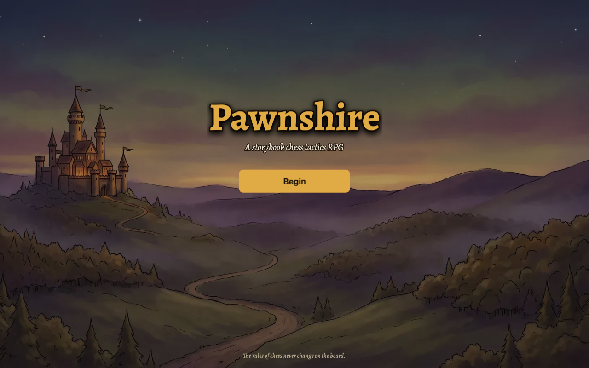
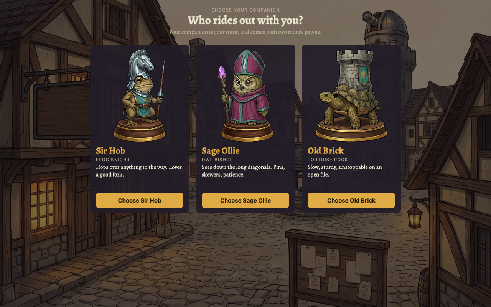
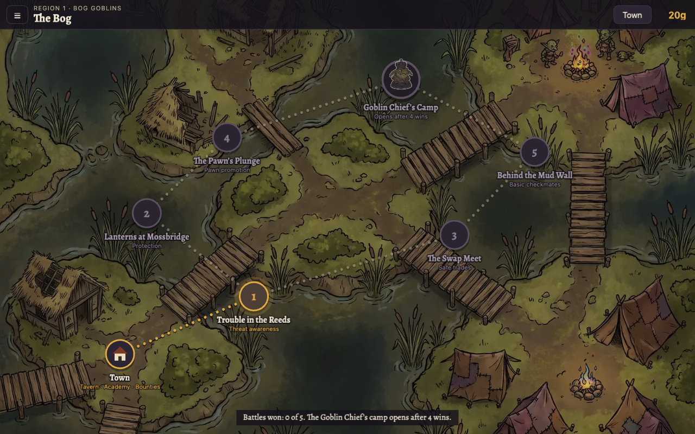
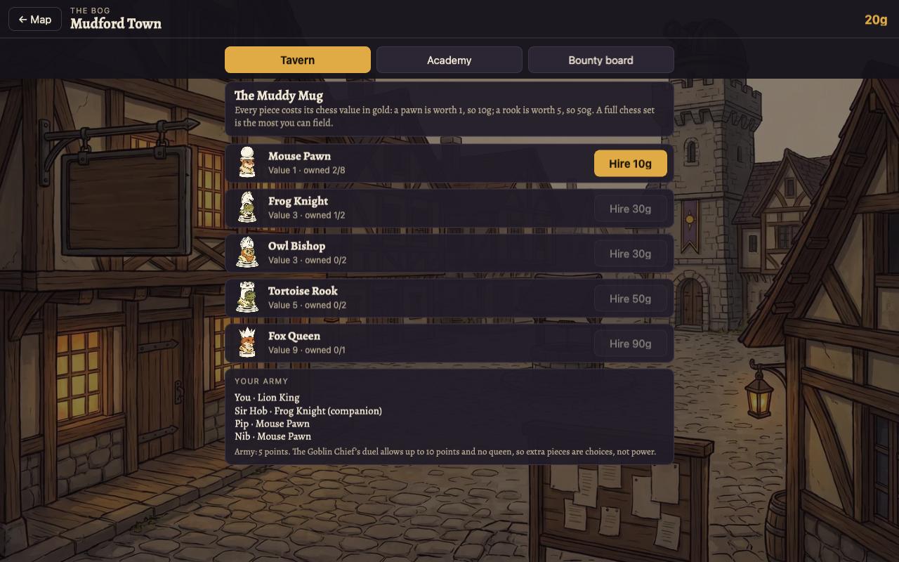
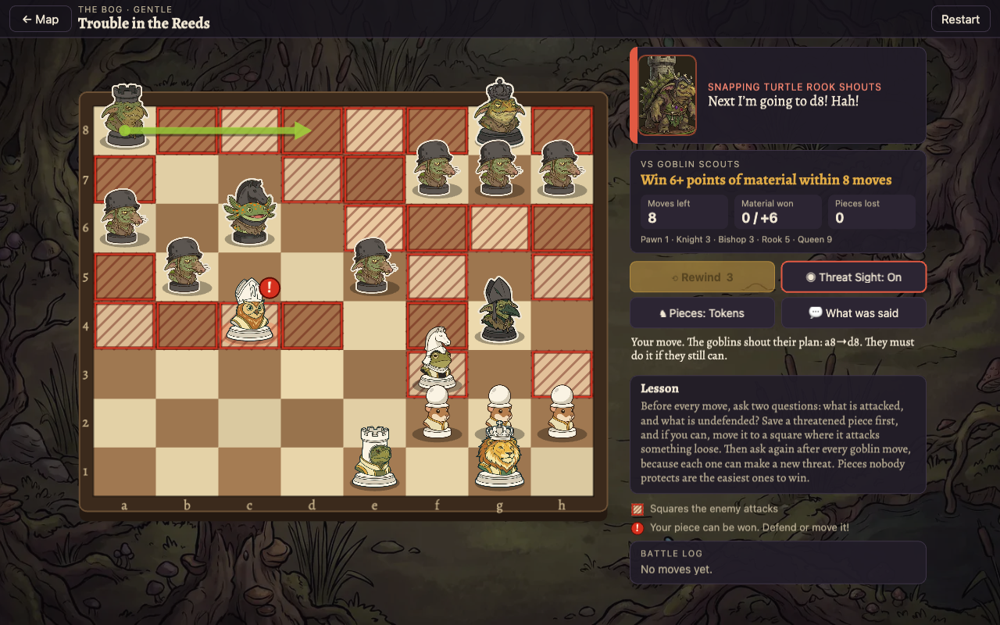
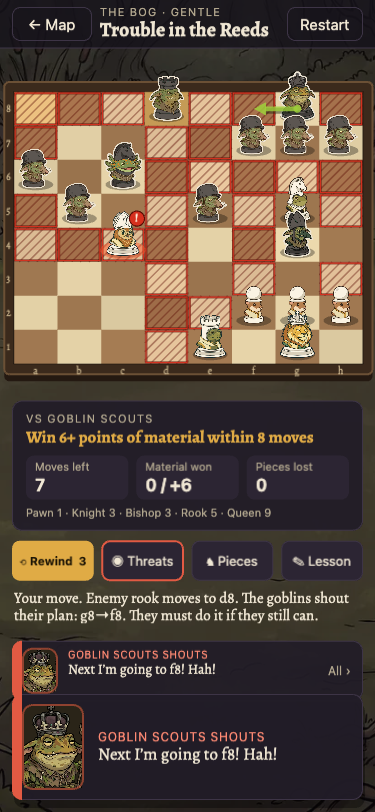

# Original Pawnshire: presentation reference

Play the frozen RPG at [alpha-chess-rpg](https://unformedideas.com/alpha-chess-rpg/).
The current journey lives at [chess-rpg](https://unformedideas.com/chess-rpg/).
Use this archive when comparing UX, art, and presentation.

## Touches to revisit

The title lets the painted castle and winding road fill the screen. Gold type and one clear action establish the storybook mood.

Companion selection gives each character a large, full-body portrait, a species, a short personality line, and a personal greeting.
These cards make the choice feel like meeting a travelling companion.

The Bog map places battle markers, dotted trails, a cottage, and the chief’s camp directly on the painted landscape.
Places feel connected to the world, with a distinct destination ahead.

Mudford Town uses its own streetscape. The tavern, academy, bounty board, and named roster make returning feel like visiting a place.
The current curriculum defers these systems; their visual treatment remains useful reference.

Battles combine animal tokens, a wooden board, expressive portraits, shouted plans, and a visible move log.
Play a capture or knight move to inspect the motion, impact, and reaction timing.

The phone layout moves battle information below the board and uses compact controls and portrait speech cards.
Treat the archive as reference, including its limitations; copy individual touches after checking the current phone layouts.

## Preservation

- Original source tag: [`pawnshire-original-live-2026-10-24`](https://github.com/avoidthekitchen/chess-rpg-gauntlet/tree/pawnshire-original-live-2026-10-24).
- Isolated archive source: [`pawnshire-alpha-2026-10-24`](https://github.com/avoidthekitchen/chess-rpg-gauntlet/tree/pawnshire-alpha-2026-10-24).
- [Downloadable original and archive builds, checksums, and manifests](https://github.com/avoidthekitchen/chess-rpg-gauntlet/releases/tag/pawnshire-alpha-2026-10-24).

The original source reproduces the live JavaScript byte for byte. All 55 original deployed files were checked before promotion.
The archive preserves every original art, font, puzzle, engine, and CSS file.
Its JavaScript differs only to prefix browser storage keys with `pawnshire-alpha:`.
Archive play and resets cannot change the main or staging game’s progress or piece preferences.

The archive uses Worker `chess-rpg-alpha`, with separate routes and deployment configuration on its frozen branch.
Future main-game deployments leave the archive intact.
Rebuild it from its tag in a separate checkout; do not merge current game changes into the archive.
