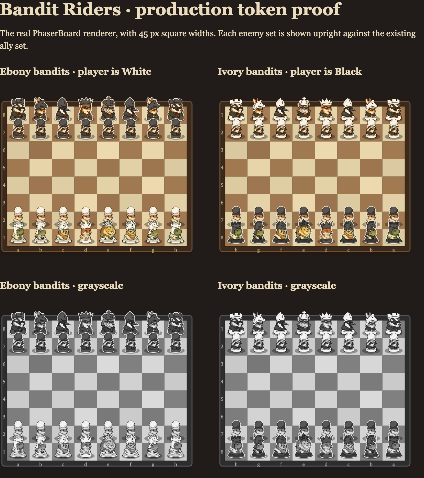
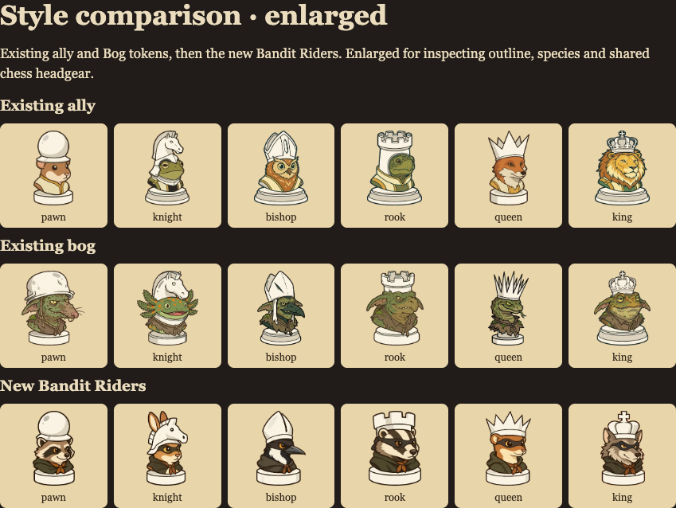
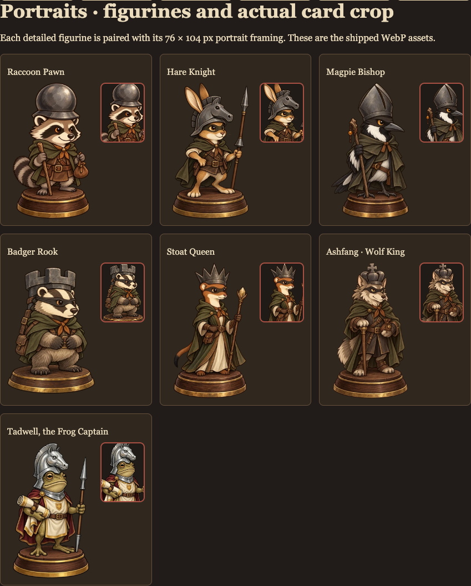
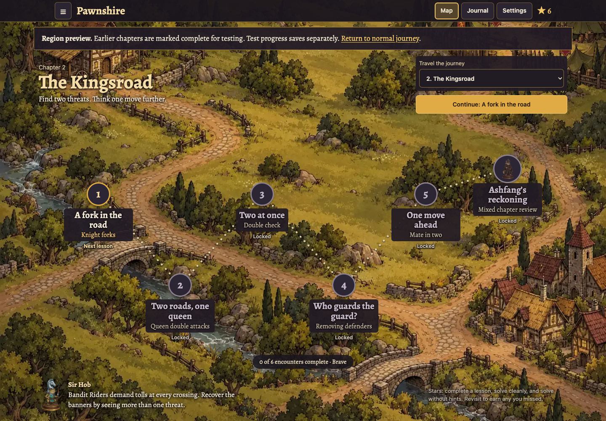
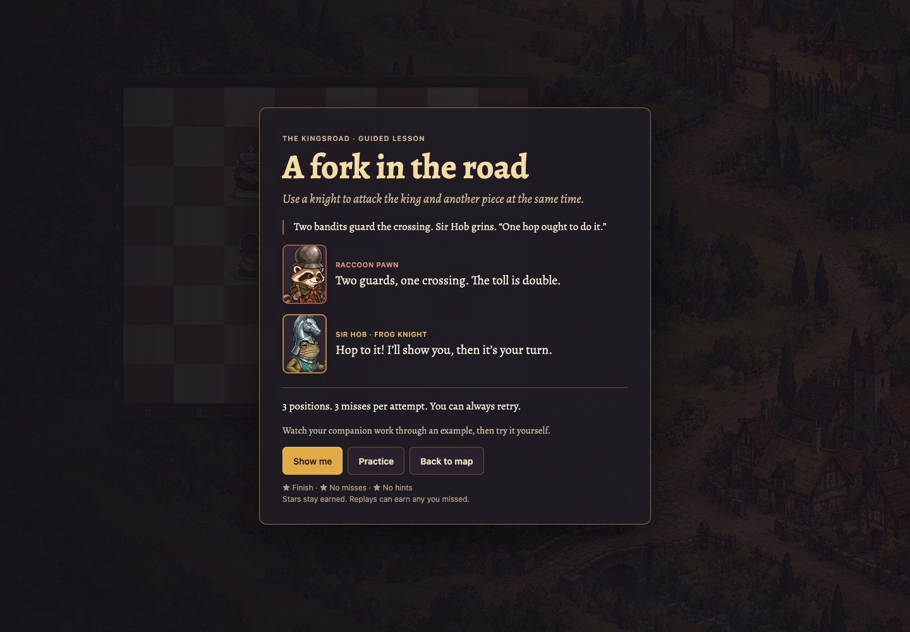
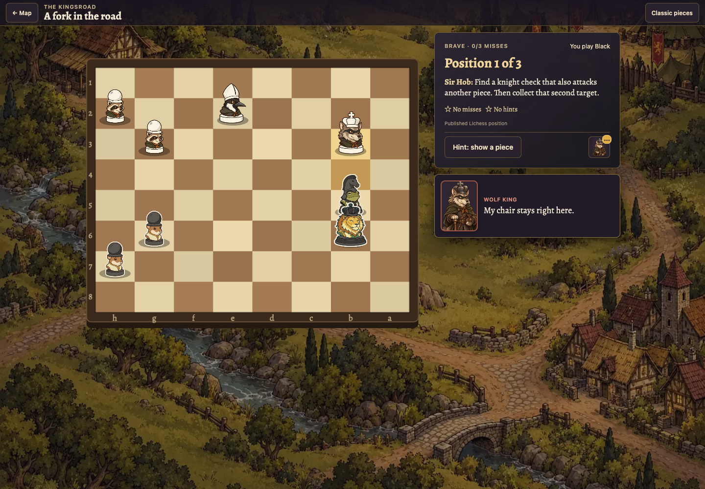
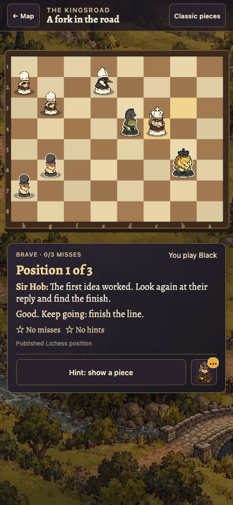
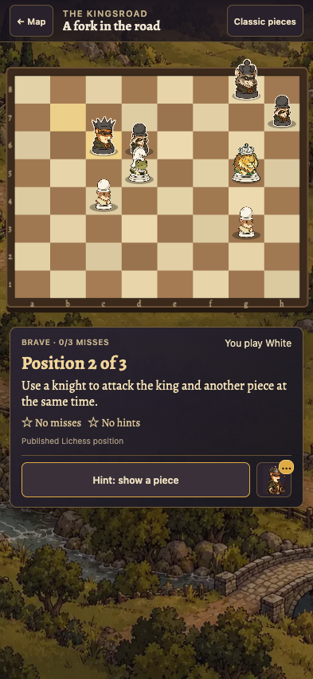
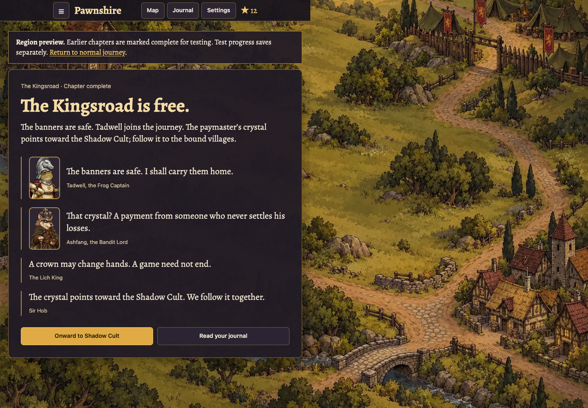
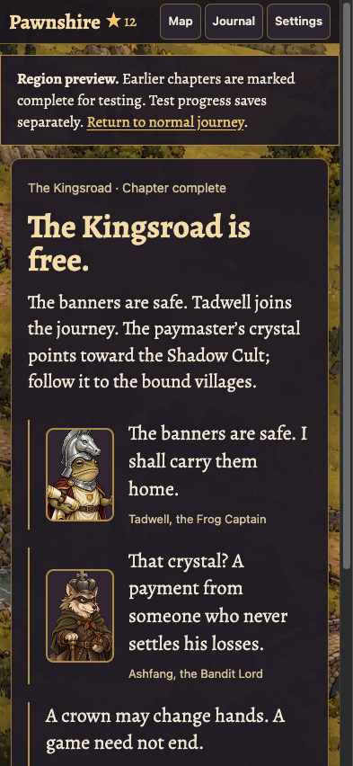

# Bandit Riders art review — issue #60

This draft implements Region 2 first. The other factions remain unchanged while the owner reviews this set.
No production or staging deployment is included.

## Assets and generation

The set contains six keyed token cutouts, twelve coloured board sprites, six faction portraits, Tadwell, and the Kingsroad map.
That is 14 original illustrations and 20 runtime assets. Two targeted native edits corrected the queen's crown and tail.

All illustrations used the native OpenAI image-generation tool. No OpenRouter request or API key was used. OpenRouter spend is **$0**.
The tool chooses its underlying model; no separate model ID is claimed.
The full prompts, references, corrections, and output paths are in [the prompt manifest](../art/bandit-prompts.json).

Raw generations stay local in `art/raw/`. The six cyan-keyed PNG cutouts in `art/tokens/` are committed.
The existing processor creates identical ivory/ebony ramps and the ebony rim for every faction.
Native portrait outputs retain their transparent backgrounds through processing.

## Independent review

An independent GPT-6 Astra art reviewer compared the set with the existing ally and Bog artwork.
The six tokens passed at 45 px square widths on the real `PhaserBoard` renderer, in both chess colours and grayscale.
This proof was shown before portrait generation. The reviewer accepted the shared silhouettes, species, colour separation, and outline style.

Review found and corrected three visual issues:

- Replaced round queen-crown finials with sharp spikes matching the existing queens.
- Replaced a fox-like portrait tail with a slim, black-tipped stoat tail.
- Top-aligned the Bandit rook portrait so its castle crenellations remain visible. Existing factions keep their original framing.

An independent GPT-6 Astra code and teaching reviewer found no blocking issue.
Published boards, replies, coaching, review prompts, progression, and saves are unchanged.
The final art review passed desktop and phone board, map, portrait, and chapter-ending views with no remaining blocker.

## Screenshots

The proof page uses the actual board renderer and the committed WebP sprites, rather than generated mock screenshots.
Run `npm run dev`, then open `/art/review/bandit.html` to inspect the set again.

### Tokens at phone size

### Comparison with the previous artwork

### Figurines and dialogue-card crops

### In the game

The ending screenshots use a completed-chapter fixture in the isolated Region 2 preview save. They do not claim a browser curriculum playthrough.

## Verification

- `npm run ci`: type-check, production build, and 510 tests passed.
- Tests require complete portraits, both token colours, and keyed sources before enabling a faction's species labels.
- Tests cover chapter art through introductions, moves for both solver colours, enemy promotion, and dialogue history.
- The map is 1600 × 1200 and 251,286 bytes, within the 250 KiB budget.
- Browser checks use Chromium at 1440 × 1000 and 393 × 852. Phone screenshots are browser emulation.
- Played a complete published wave and entered the next wave, covering Black and White player boards. Checked the classic-piece toggle.
- The final in-game browser session reported no artwork loading errors.

## Continuing the same PR

Keep this PR in draft until the owner judges the assets and screenshots.
Only after that review, add Bone Wardens, Shadow Cult, and Iron Legion to the same branch.
Issue #60 remains open because this draft covers only Region 2.
