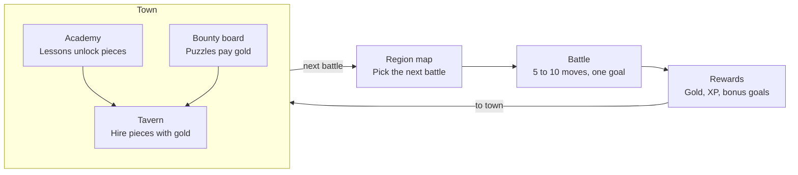

# Chess RPG Gauntlet — Game Design Doc

October 21, 2026 · Exported from the [Claude Doc](https://claude.ai/artifact/VefDVarJQaXZKM4xbvPBAU)

## Vision and pillars

A fantasy tactics RPG that teaches real chess. You are a king who starts with almost no army, recruits pieces by learning how they work, and fights short, puzzle-like battles that build up to a full game against the Lich King. It plays like Into the Breach: short battles, nothing hidden, and every turn a small puzzle with a clever answer.

**Pillars**

1. **The rules of chess are sacred on the board.** No terrain that changes movement, no extra moves, no rule-bending powers. The RPG lives around the board, so every skill carries over to real chess.
2. **Short, sharp battles.** Most battles last 5 to 10 moves and have a clear goal. Full games are saved for bosses.
3. **Every reward teaches.** Prices, unlocks and bonus goals all reinforce a chess idea, like piece values, tactical patterns or safe-move habits.
4. **Mistakes are cheap, lessons are clear.** Losing a battle or a piece never ruins a run. A review after each battle always shows what went wrong.
5. **Help that fades.** Assists like threat highlights scale down with difficulty and skill, so players build the habit instead of leaning on the hint.

**Setting:** an ancient magical kingdom. Pawns are squires, bishops are mages, rooks are stone golems or siege towers, and the queen is a champion sorceress. The final villain is the Lich King, a light wink at Lichess.

## Core loop

Pick a battle on the region map, win it for gold and XP, then spend in town before the next battle.

Lessons at the academy unlock which pieces the tavern sells, and puzzle bounties top up gold. Clearing a region's battles opens its boss duel, which leads to the next region.

## Battles

Battles are short scenarios on a standard 8×8 board, each with a goal, a move limit and bonus objectives. They borrow what makes Into the Breach fun without changing how pieces move.

| Into the Breach | Chess version |
| --- | --- |
| Enemies show their attacks in advance | **Threat Sight:** highlights squares the enemy attacks and your undefended pieces. Fades with difficulty. |
| Battles last about 5 turns | Move limits: "checkmate within 6 moves", "survive 8 turns" |
| Goals beyond killing (protect buildings) | Protect villages, escort a squire to promotion, capture the standard-bearer |
| One shot hits two enemies | Forks, skewers and discovered attacks are detected and celebrated |
| Bonus objectives | "Win without losing a piece", "Use a pin", "Under 10 moves" → extra gold |
| One Reset Turn per battle | Rewind charges (see Powers and rewind) |

**Battle types**

1. **Skirmish:** small armies. Checkmate, or win material within a set number of moves.
2. **Ambush:** a real puzzle position ("the enemy walked into your trap, find the strike"), then play it out to a win against the AI. Turning an advantage into a win is a skill puzzles alone don't teach.
3. **Siege:** survive a set number of turns while protecting village squares. Teaches defence and prophylaxis.
4. **Promotion run:** escort a squire to the far rank, where it's knighted in a promotion ceremony. Teaches pawn endgames.
5. **Boss duel:** a nearly full or full game against a faction leader.

**Tactic detection.** When a move creates a known pattern, the game shows a banner like **FORK!**, **PIN!** or **SKEWER!** and pays bonus gold, like a combo in a fighting game. Start with patterns that are easy to detect reliably (fork, check plus attack, discovered attack, back-rank mate) and add more later.

**Scenario format** (one JSON file per battle): starting position (FEN), goal, move limit, enemy faction and AI settings, bonus objectives, rewards, and the dialogue before and after.

## Your army

You start as a king with one chosen piece and two squires, and build toward a full chess set by learning and earning.

**Starter choice.** Pick a Rook, Bishop or Knight, Pokémon-style. Each starter comes with 2 pawns (squires). King + Bishop and King + Knight alone cannot checkmate a lone king, so the squires make every starter viable and give you your first promotion story.

**Hiring rules**

- A piece type can only be hired after its lesson is done at the academy.
- Army size is capped at a real chess set: 8 pawns, 2 knights, 2 bishops, 2 rooks, 1 queen.
- Price equals standard piece value, so players learn values just by shopping:

| Piece | Fantasy role | Value | Price |
| --- | --- | --- | --- |
| Pawn | Squire | 1 | 10g |
| Knight | Knight | 3 | 30g |
| Bishop | Battle mage | 3 | 30g |
| Rook | Stone golem | 5 | 50g |
| Queen | Champion sorceress | 9 | 90g |

**Wounds, not permadeath.** A captured piece is wounded and sits out the next battle. If you win, sacrificed pieces return right away with a Valor bonus. Permadeath would teach players never to sacrifice, which is bad chess.

**Pieces as tutors.** Each piece type has a character who teaches its tactics: the knight teaches forks, the bishop-mage teaches pins and long diagonals, the rook teaches back-rank mates. Pieces earn XP and titles with small meta perks (like +1 hint), never new moves.

**Avoiding grind.** Gold comes from varied, short content: battle rewards, bonus objectives, side quests, and a tavern bounty board of puzzles. No required replays of the same practice game.

## Enemies and difficulty

Each region has one enemy faction built around one chess theme. Enemies grow from a handful of pieces to a full set, and their AI gets stronger along the way.

| Region | Faction | Army style | Teaches |
| --- | --- | --- | --- |
| 1 | Goblin Horde | Many pawns, a goblin chief as king | Piece movement, basic checkmates, taking undefended pieces |
| 2 | Bandit Riders | Knight-heavy | Forks and double attacks |
| 3 | Shadow Cult | Bishops and a queen | Pins, skewers, x-rays |
| 4 | Iron Legion | Rooks and pawns | Back-rank mates, rook and pawn endgames |
| Final | The Lich King | Full army | A full game |

An optional Goblin Horde boss could use the Horde chess variant (36 pawns, no king). That needs a variant engine such as Fairy-Stockfish.

**AI personalities.** Enemy commanders have readable habits that create lessons. The orc warlord always grabs free material, which teaches traps. The cult leader pins everything, which teaches unpinning. Personality is a layer over the engine: weighted move choice among the engine's top candidates.

**Human-like mistakes.** Stockfish at low skill levels mixes perfect moves with random blunders, which feels unnatural. Early enemies should make believable mistakes, like missing a fork or leaving a piece undefended. Use a small custom engine or a shallow search with noise early on, and bring in Stockfish for later regions.

**Difficulty in two layers**

- **Global setting:** Squire / Knight / Champion / Grandmaster. Sets the AI strength offset and how much help you get (Threat Sight, blunder warnings, rewind charges).
- **Adaptive rating:** a hidden rating (Glicko-style) from puzzles and battles keeps the AI near the player's level, with the global setting as an offset.

## Powers and rewind

Undo is unlimited in training and limited in battles, like Into the Breach's one Reset Turn. Scarce rewinds are what make players double-check before moving, and that habit is the skill being taught.

| Context | Undo | Hints | Why |
| --- | --- | --- | --- |
| Lessons and training grounds | Unlimited | Free | Safe space to explore |
| Battles | Rewind charges (start with 1) | Paid with powers | Consequences build the blunder-check habit |
| After every battle | Full review | Best move shown | Learn from the biggest mistake |

**Rewind relics.** Rewind can be upgraded: more charges per battle, or rewinding two moves at once.

**Free rewind if you can explain it.** A rewind costs nothing if the player can point to the enemy move that punishes their mistake. You only pay when you can't see why your move was bad.

**Learning-friendly powers**

- **Scrying Orb:** reveals the enemy's planned next move, the Into the Breach telegraph. Teaches "what does my opponent want?"
- **Oracle:** highlights which piece the best move uses, but not where it goes.
- **Blunder Ward:** warns once per battle when you're about to leave a piece undefended.
- **Threat Sight:** always available on easy difficulty, a limited power on harder ones.

**Banned power types:** anything that changes how pieces move, gives extra moves, swaps pieces, or adds terrain. Fun, but they teach the wrong chess.

## Campaign and Gauntlet

The game has two modes: a Campaign that saves progress and teaches in order, and a Gauntlet roguelite for replay.

**Campaign.** A map of 4 or 5 regions. Each region has:

- 4 to 6 battles, chosen from a branching map like Into the Breach's islands
- a town with a tavern (hire pieces), an academy (lessons), and a bounty board (puzzles for gold)
- a boss duel against the faction leader

Lessons learned and pieces unlocked are permanent. Losing a battle costs gold or renown, never the save.

**Gauntlet.** A run with random battles, relics and a fresh army each time, unlocked after the first region. Knowledge (lesson unlocks) carries over between runs; army and gold do not. Losing your king ends the run. A Story difficulty option keeps runs forgiving for new players.

## Curriculum

The Lichess [Learn](https://lichess.org/learn), [Practice](https://lichess.org/practice) and [puzzle themes](https://lichess.org/training/themes) pages are the outline for what each region teaches. The lessons themselves are our own writing.

| Region | Academy lessons (unlocks) | Practice themes | Puzzle tags for bounties |
| --- | --- | --- | --- |
| 1 Goblin Horde | Each piece's movement (unlocks hiring it), capture, protection, check, mate in one | Piece checkmates I (queen, rook) | mateIn1, hangingPiece |
| 2 Bandit Riders | Piece value, check in two, castling | The fork, double check | fork, doubleCheck, mateIn2 |
| 3 Shadow Cult | En passant, stalemate | The pin, the skewer, x-ray, discovered attacks | pin, skewer, xRayAttack, discoveredAttack |
| 4 Iron Legion | Promotion and basic endgames | Checkmate patterns, overloaded pieces, pawn and rook endgames | backRankMate, promotion, rookEndgame, pawnEndgame |
| Final | Review of all themes | Deflection, attraction, zwischenzug | deflection, attraction, intermezzo |

Puzzle tags follow the Lichess puzzle database's theme names; check exact spellings against the database when building the pipeline.

## Tech stack and deployment

Use a web stack built on TypeScript, not Godot, because the chess tools (rules, engine, puzzle data) are all JavaScript-friendly.

| Layer | Choice | Notes |
| --- | --- | --- |
| Build | Vite + TypeScript | Static output |
| Menus, shop, dialogue | Svelte or React | Far easier in HTML/CSS than in a game engine |
| Board and effects | PixiJS or Phaser | A plain DOM/SVG board is fine for the first prototype |
| Chess rules | chess.js (BSD) | Legal moves, FEN, game state |
| AI | Stockfish WASM, lite single-threaded build (about 7 MB) | Runs in a Web Worker; no special server headers needed |
| Early-game AI | Small custom engine | Human-like mistakes for early enemies |
| Puzzles | Lichess puzzle database (CC0) | Pre-filter to tens of thousands, split into small JSON files at build time |
| Hosting | Cloudflare static assets, free tier | 25 MiB per-file limit |
| iOS | Capacitor | Wraps the same web build |
| Saves | Local storage first | Cloud sync later if needed |

**Why not Godot:** it means bridging to Stockfish yourself, a bigger web download, and building every menu in Godot's UI system. **Why not Three.js:** only worth it for a 3D board.

**Art.** Start 2D: pixel art like Into the Breach, or illustrated sprites. Skip Blender for now. If 3D-looking pieces are wanted later, render Blender models to 2D sprites.

## Licensing

Using Stockfish means the game should be open source under GPL-3. Decide this before writing code.

| Asset | License | What it means for us |
| --- | --- | --- |
| Lichess puzzle database | CC0 (public domain) | Free to use and ship |
| chess.js | BSD-2 | Free to use, keep the notice |
| Stockfish | GPL-3 | Game source must be published under GPL-3 if we ship it |
| chessground (Lichess board UI) | GPL-3 | Same as Stockfish; or write our own board |
| Lichess site code (lila) | AGPL-3 | Don't copy code unless the game is AGPL too |
| Learn and Practice lesson text | Not checked | Write our own lessons; use theirs only as an outline |

- GPL apps can ship on the App Store: the official Lichess mobile app is GPL-3 and on the App Store.
- For closed source, drop Stockfish and chessground and use our own board and engine.
- Keep "Lichess" out of the game's name and branding. The canonical code repo is lichess-org/lila; the alexbarrett/lichess link looks like an old copy.

## Prototype plan

Build a small playable slice with placeholder art to test whether battles are fun before spending on art or content. The test: if a handmade battle plays like a satisfying puzzle, the game works.

1. **Battle core:** board, chess.js rules, Stockfish in a Web Worker, Threat Sight, one rewind charge.
2. **Scenarios:** the JSON scenario format and about 6 handmade battles covering Skirmish, Ambush, Siege and Promotion run.
3. **Tactic detection:** FORK! and discovered attack banners with bonus gold.
4. **One town:** hiring with prices by value, one academy lesson, and a bounty board with 50 puzzles from the Lichess database.
5. **One boss:** the Goblin chief duel, ending region 1.
6. **Playtest:** watch 3 to 5 people play, ideally beginners, before building more.

## Open questions

- [ ] Audience: total beginners, or players who know the moves and want to improve? Sets how much hand-holding region 1 needs.
- [ ] Build Campaign first, or Gauntlet first?
- [ ] Open source under GPL (use Stockfish), or closed source (own engine and board)?
- [ ] Art style: pixel art, illustrated 2D, or pre-rendered 3D sprites?
- [ ] Should losing a battle cost gold, renown, or nothing in Campaign mode?
- [ ] How many tactic patterns can be detected reliably for the first release?
