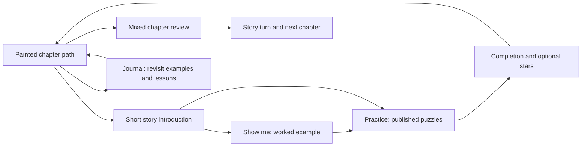

# Pawnshire — Game Design Doc

## Vision and pillars

Pawnshire is a storybook chess learning adventure. Travel with an animal companion, learn from published chess positions, and free the kingdom chapter by chapter.
The Lich King cannot accept losing. The player progresses by learning from mistakes.

**Audience:** players who know how chess pieces move. The current entry provides a movement reminder and links to Lichess Learn.
An integrated beginner course is not built.

1. **Real chess.** Board rules never change. Use published Lichess positions and replies without rewriting them for the story.
2. **Clear teaching.** Show an idea, practise it, then recognise it without a theme label. Coaching must describe the actual position.
3. **Progress through learning.** Complete lessons and revisit earlier skills. Gold, recruitment, powers, and live army bosses are not prerequisites.
4. **Mistakes are recoverable.** Attempts can always be retried. No permanent lockout, lost save, or payment blocks learning.
5. **A story worth following.** Keep named companions, faction personalities, painted maps, introductions, dialogue history, and accurate celebrations.
6. **Readable on a phone.** Teaching advice has priority. Temporary speech never occupies its scroll area or covers its controls.

**Product goal:** a polished web game and eventual commercial iOS app. The source is GPL-3; shipped content needs suitable reuse rights.
Published sources support content reliability, but do not prove our syllabus produces measured learning gains.

## Core loop

The shown example is optional. Practice gives help according to the selected difficulty.
Chapter reviews use fresh positions and neutral prompts, so the player must recognise the idea.
Completion opens the next encounter; clean and no-hint stars reward optional replay.
Scheduled refreshers and dedicated technique exercises are planned, not part of the current release.

## Built and next

The Bog and The Kingsroad are built: five guided lessons and a mixed review each, using 88 distinct published positions.
The accepted build is available on [staging](https://unformedideas.com/staging-chess-rpg/).
The original game at `/chess-rpg/` remains separate until an explicit production release.

Next: implement [Region 3](design/regions/region-03-shadow-cult.md), following the [remaining syllabus](design/syllabus.md).
Then expand through the Iron Legion, Bone Wardens, and a Lich King capstone.
Faction-specific art can improve each chapter without blocking its teaching content.

## Detailed design

| Document | Authority |
| --- | --- |
| [Campaign](design/campaign.md) | Path, chapter progression, source types, built scope |
| [Syllabus](design/syllabus.md) | Skills, prerequisites, revisits, assessments, and coverage gaps |
| [Systems](design/systems.md) | Current attempts, help, saves, stars, and tuning |
| [Story and voice](design/story.md) | Setting, cast, chapter arc, and dialogue |
| [Names](design/glossary.md) | Established names and terminology |
| [Art](design/art.md) | Token readability, portraits, and storybook direction |
| [Technical design](design/technical.md) | Architecture, deployment, and licensing |
| [Decisions](design/decisions.md) | Current decisions, open work, and historical record |
| [Playbook](playbook.md) | Content selection, verification, review, and release |
| [Region template](design/regions/region-template.md) | Checklist for adding a chapter |

The [accepted two-chapter scope](curriculum-first.md) records the delivered baseline. New chapter plans must distinguish proposed content from implemented features.
The [legacy overview](legacy-design.md) preserves the original RPG plan. Its custom battles, economy, powers, and army bosses are deferred.
Implementation and verification history lives in [build progress](progress.md).
