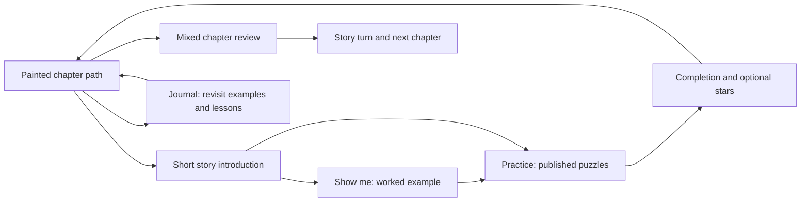

# Pawnshire — Game Design Doc

## Vision and pillars

Pawnshire is a storybook chess learning adventure. Travel with an animal companion, learn from published chess positions, and free the kingdom chapter by chapter.
The Lich King cannot accept losing. The player progresses by learning from mistakes.

**Audience:** players who know how chess pieces move. The current entry provides a movement reminder and links to Lichess Learn.
An integrated beginner course is not built.

1. **Real chess.** Board rules never change. Use published Lichess positions and replies without rewriting them for the story.
2. **Clear teaching.** Show an idea, practise it, then recognise it without a theme label. Coaching must describe the actual position.
3. **Progress through learning.** Complete lessons and revisit earlier skills. Gold, recruitment, powers, and live army bosses are not prerequisites.
4. **Mistakes are recoverable.** Attempts can always be retried. No permanent lockout, lost save, or payment blocks learning.
5. **A story worth following.** Keep named companions, faction personalities, painted maps, introductions, dialogue history, and accurate celebrations.
6. **Readable on a phone.** Keep the board visible. Temporary speech may cover advice on compact screens, but never board squares or action buttons. Move banners briefly cover the board only between moves.

**Product goal:** a polished web game and eventual commercial iOS app. The source is GPL-3; shipped content needs suitable reuse rights.
Published sources support content reliability, but do not prove our syllabus produces measured learning gains.

## Core loop

The shown example is optional. Practice gives help according to the selected difficulty.
Chapter reviews use fresh positions and neutral prompts, so the player must recognise the idea.
Completion opens the next encounter; clean and no-hint stars reward optional replay.
Scheduled refreshers and dedicated technique exercises are planned, not part of the current release.

## Production scope and next

Regions 1–5 and the Lich King finale are implemented, using 273 distinct published positions.
The first two chapters have five lessons each. Regions 3–5 have six lessons each, with seven-, six-, and six-wave reviews.
The owner published the accepted curriculum at [production](https://unformedideas.com/chess-rpg/) on 2026-10-24.
[Staging](https://unformedideas.com/staging-chess-rpg/) remains the preview destination.
The original game is archived at [alpha](https://unformedideas.com/alpha-chess-rpg/) as an [original-game reference](alpha-reference.md).

The complete path has 28 lessons, five chapter reviews, and two final mixed encounters.
Dedicated technique exercises and adaptive refreshers remain future work in the [syllabus](design/syllabus.md).
Release checks and deployment evidence are recorded in [progress](progress.md) and the [release record](complete-journey-release.md).
The owner accepted the major feedback and deferred follow-ups #53–62. The owner accepted 393×852 WebKit emulation for this check; no physical-device coverage is claimed.
Faction-specific art can improve each chapter without blocking its teaching content.

## Detailed design

| Document | Authority |
| --- | --- |
| [Campaign](design/campaign.md) | Path, chapter progression, source types, built scope |
| [Syllabus](design/syllabus.md) | Skills, prerequisites, revisits, assessments, and coverage gaps |
| [Systems](design/systems.md) | Current attempts, help, saves, stars, and tuning |
| [Story and voice](design/story.md) | Setting, cast, chapter arc, and dialogue |
| [Names](design/glossary.md) | Established names and terminology |
| [Art](design/art.md) | Token readability, portraits, and storybook direction |
| [Technical design](design/technical.md) | Architecture, deployment, and licensing |
| [Decisions](design/decisions.md) | Current decisions, open work, and historical record |
| [Playbook](playbook.md) | Content selection, verification, review, and release |
| [Region template](design/regions/region-template.md) | Checklist for adding a chapter |

The [accepted two-chapter scope](curriculum-first.md) records the delivered baseline. New chapter plans must distinguish proposed content from implemented features.
The [legacy overview](legacy-design.md) preserves the original RPG plan. Its custom battles, economy, powers, and army bosses are deferred.
Implementation and verification history lives in [build progress](progress.md).
