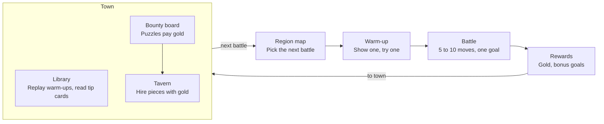

# Pawnshire — Game Design Doc

## Vision and pillars

A fantasy tactics RPG that teaches real chess. You are a king who starts with almost no army, recruits pieces with gold won in battle, and fights short, puzzle-like battles that build up to a full game against the Lich King. It plays like Into the Breach: short battles, nothing hidden, and every turn a small puzzle with a clever answer.

**Audience:** players who know how the pieces move and want to get better. The game opens by asking "Do you know how the pieces move?"; answering no starts the optional "Teach me the moves" tutorial.

**Pillars**

1. **The rules of chess are sacred on the board.** No terrain that changes movement, no extra moves, no rule-bending powers. The RPG lives around the board, so every skill carries over to real chess.
2. **Short, sharp battles.** Most battles last 5 to 10 moves and have a clear goal. Full games are saved for bosses.
3. **Every reward teaches.** Prices, boss budgets and bonus goals all reinforce a chess idea, like piece values, tactical patterns or safe-move habits.
4. **Mistakes are cheap, lessons are clear.** Losing a battle or a piece never ruins a run. A review after each battle always shows what went wrong.
5. **Help that fades.** Assists like threat highlights scale down with difficulty and skill, so players build the habit instead of leaning on the hint.

**Goals:** a commercial product, sold as an iOS app and also playable on the web. The code is open source (GPL-3), and that's fine: the product is the polished game, art and ongoing content, not secret code. Anything we ship, whether code, art or data, needs a license that allows commercial use.

## Build order: core game first

Decided 2026-10-24. Build a complete basic game first: every Region and the Lich King playable, teaching from proven Lichess material. Flavor and RPG systems come after, once the core game teaches well from start to finish.

- **In the core game:** the map, ambushes made of published Lichess puzzles ([Encounter kinds](design/campaign.md#encounter-kinds)), technique nodes from Lichess Practice for the endgames puzzles can't teach, a live boss game per Region, bounties, gold, hiring, and the four difficulties. Region 1 keeps its five built battles.
- **After the core game:** faction habits beyond what's built, the Scrying Orb and the other powers, heroes, XP, a role for your army outside bosses, new custom battles, faction art for Regions 2–5, the library and refresher bounties. The [later list](design/decisions.md#open-todos) tracks them.

Why: fitting those systems into every battle slowed the game down, and each custom battle needed rounds of engine playtests. Lichess puzzles come with checked solutions and ratings, so a new Region needs puzzle selection and words, not new positions.

## Core loop

Pick a battle on the region map, learn its idea in a short warm-up, win it for gold, then spend in town before the next battle.

From Region 2 on, most map nodes are **ambushes**: your companion shows one position, then you break four waves of real Lichess puzzles. The show-one step does the warm-up's job, and the waves are the test.

Each step has one job. The **warm-up** teaches a battle's idea right before the battle, with nothing at stake. The **battle** tests it under pressure (goals, move limits, scarce rewinds, gold at stake). **Bounties** repeat it with real puzzles until it sticks, and bring back the ideas you got wrong. The map leads you through the ideas every player needs and lets you choose the rest ([Guided path](design/campaign.md#guided-path)). Four wins in the right places open the boss duel ([the rule](design/campaign.md#guided-path)), which leads to the next region.

## Detailed design

| Document | Contents |
| --- | --- |
| [Game systems](design/systems.md) | Battles, army, gold, enemies, AI habits by faction, powers and rewind, tuning values |
| [Campaign and curriculum](design/campaign.md) | Campaign structure, factions, teaching progression and Gauntlet |
| [Story and recurring characters](design/story.md) | Setting, main arc, recurring cast and voice guide |
| [Names and terms](design/glossary.md) | Piece, faction, place and game-term names used everywhere |
| [Art direction](design/art.md) | Board tokens, portraits, asset pipeline and deferred 3D exploration |
| [Technical design and licensing](design/technical.md) | Tech stack, deployment and licenses |
| [Decisions and open questions](design/decisions.md) | Open TODOs, tuning questions and decision log |

## Regions

- [Region 1: Bog Goblins](design/regions/region-01-bog-goblins.md) — built and deployed; the worked example for every Region.
- [Region template](design/regions/region-template.md) — copy it to start a new Region.
- [Regions 2–5 and the Lich King](design/campaign.md#regions-and-factions) — existing faction and curriculum summaries; detailed Region documents are still [open TODOs](design/decisions.md#open-todos).

Shared rules live in the topic documents above; Region documents hold local content and link to those rules. The [story document](design/story.md) holds the overall arc and recurring cast; Region documents hold their local stories and characters. Each detailed document links back here.

[Region 1 build progress](progress.md) records implementation history separately from the design. The [playbook](playbook.md) describes how to build and check a Region.
