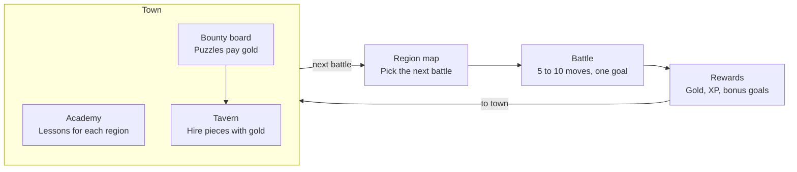

# Chess RPG Gauntlet — Game Design Doc

October 21, 2026 · Exported from the [Claude Doc](https://claude.ai/artifact/VefDVarJQaXZKM4xbvPBAU)

## Vision and pillars

A fantasy tactics RPG that teaches real chess. You are a king who starts with almost no army, recruits pieces with gold won in battle, and fights short, puzzle-like battles that build up to a full game against the Lich King. It plays like Into the Breach: short battles, nothing hidden, and every turn a small puzzle with a clever answer.

**Audience:** players who know how the pieces move and want to get better. The game opens by asking "Do you know how the pieces move?"; answering no starts the optional "Teach me the moves" tutorial.

**Pillars**

1. **The rules of chess are sacred on the board.** No terrain that changes movement, no extra moves, no rule-bending powers. The RPG lives around the board, so every skill carries over to real chess.
2. **Short, sharp battles.** Most battles last 5 to 10 moves and have a clear goal. Full games are saved for bosses.
3. **Every reward teaches.** Prices, boss budgets and bonus goals all reinforce a chess idea, like piece values, tactical patterns or safe-move habits.
4. **Mistakes are cheap, lessons are clear.** Losing a battle or a piece never ruins a run. A review after each battle always shows what went wrong.
5. **Help that fades.** Assists like threat highlights scale down with difficulty and skill, so players build the habit instead of leaning on the hint.

**Setting:** an animal kingdom of ancient magic, told like a storybook. Each piece type is a species whose body hints at how it moves: frog knights hop over pieces, tortoise rooks carry a castle on their backs. Factions differ by outfit and color. The final villain is the Lich King, who leads skeleton versions of every species (a light wink at Lichess).

## Core loop

Pick a battle on the region map, win it for gold and XP, then spend in town before the next battle.

The academy teaches each region's themes, and puzzle bounties top up gold. Clearing a region's battles opens its boss duel, which leads to the next region.

## Battles

Battles are short scenarios on a standard 8×8 board, each with a goal, a move limit and bonus objectives. They borrow what makes Into the Breach fun without changing how pieces move.

| Into the Breach | Chess version |
| --- | --- |
| Enemies show their attacks in advance | **Threat Sight:** highlights squares the enemy attacks and your undefended pieces. Fades with difficulty. |
| Battles last about 5 turns | Move limits: "checkmate within 6 moves", "survive 8 turns" |
| Goals beyond killing (protect buildings) | Protect villages, escort a squire to promotion, capture the standard-bearer |
| One shot hits two enemies | Forks, skewers and discovered attacks are detected and celebrated |
| Bonus objectives | "Win without losing a piece", "Use a pin", "Under 10 moves" → extra gold |
| One Reset Turn per battle | Rewind charges (see Powers and rewind) |

**Battle types**

1. **Skirmish:** small armies. Checkmate, or win material within a set number of moves.
2. **Ambush:** a real puzzle position ("the enemy walked into your trap, find the strike"), then play it out to a win against the AI. Turning an advantage into a win is a skill puzzles alone don't teach.
3. **Siege:** survive a set number of turns while protecting village squares. Teaches defence and prophylaxis.
4. **Promotion run:** escort a squire to the far rank, where it's knighted in a promotion ceremony. Teaches pawn endgames.
5. **Boss duel:** a nearly full or full game against a faction leader.

**Your pieces in battle.** Every piece type can be used from the start, because players either finished the tutorial or said they know the moves. Lesson battles (skirmish, siege, promotion run) use a set lineup chosen by the scenario: pieces you've hired appear as your named characters, and the rest as unnamed militia. Ambush battles use the puzzle position as it is. Boss duels let you pick your army up to a points budget, using standard piece values. The budget grows by region, from about 10 points in region 1 to the full 39 of a complete chess set, which only the Lich King battle allows. A boss can also cap specific piece types when its lesson needs it, for example no queen in region 1. Every captured piece comes back after the battle, win or lose.

**Tactic detection.** When a move creates a known pattern, the game shows a banner like **FORK!**, **PIN!** or **SKEWER!** and pays bonus gold, like a combo in a fighting game. A banner must only appear when the tactic really works, or it teaches the wrong lesson: a "fork" where the forking piece simply gets captured is not a fork. So each banner needs two checks: a board rule spots the pattern, and the engine confirms the move actually wins something.

- **At launch (clear board rules):** checkmate, fork, double check, discovered attack, pin, skewer, back-rank mate, promotion.
- **Puzzles only (need judgment):** deflection, attraction, overloaded piece, zwischenzug, clearance, interference. These are hard to name automatically in live play, so they appear in puzzles, where the Lichess database already tags them.
- The prototype already detects checkmate, fork, check, promotion and capture, without the engine check yet.

**Scenario format** (one JSON file per battle): starting position (FEN) or, for bosses, the points budget and enemy setup; goal, move limit, enemy faction and AI settings, bonus objectives, rewards, and the dialogue before and after.

## Your army

You start as a king with one companion and two squires, and build toward a full chess set by learning and earning.

**Starter companion.** Pick a frog knight, an owl mage (bishop) or a tortoise golem (rook), Pokémon-style. The starter is a named character who acts as your main tutor: they speak in dialogue, comment on your moves, level up and stay with you all game. Each starter comes with 2 mouse squires (pawns), because King + Bishop or King + Knight alone can't checkmate a lone king.

**Hiring rules**

- Every piece type can be hired from the start; gold is the only limit.
- Army size is capped at a real chess set: 8 pawns, 2 knights, 2 bishops, 2 rooks, 1 queen.
- Price equals standard piece value, so players learn values just by shopping.
- Gold and the growing boss budget set the pace: owning more pieces than a boss budget allows gives you choices, not extra power.

| Piece | Species | Why it fits | Value | Price |
| --- | --- | --- | --- | --- |
| Pawn | Mouse squire | Small, and there are many | 1 | 10g |
| Knight | Frog | Jumps over other pieces | 3 | 30g |
| Bishop | Owl mage | Robed and scholarly | 3 | 30g |
| Rook | Tortoise | Castle on its back, moves in straight lines | 5 | 50g |
| Queen | Fox sorceress | Fast, goes anywhere | 9 | 90g |
| King | Lion | Regal; this is you | — | — |

**No wounds.** Captured pieces return after every battle, so a sacrifice never has a lasting cost. Losing material still hurts inside the battle, which is the real chess lesson.

**Pieces as tutors.** Besides the starter, each piece type has a character voice that teaches its tactics: the frog knight teaches forks, the owl mage teaches pins and long diagonals, the tortoise teaches back-rank mates. Pieces earn XP and titles with small meta perks (like +1 hint), never new moves.

**Named hero recruits.** Each region rewards you with a named hero who joins your party with a portrait and dialogue, for example a frog knight captain after beating the Bandit Riders. Heroes give each region a "new companion" moment without locking any piece types.

**Avoiding grind.** Gold comes from varied, short content: battle rewards, bonus objectives, side quests, and a tavern bounty board of puzzles. No required replays of the same practice game.

## Bounty board and gold

Battles pay for the army; bounties pay for extras and catch-up, and every bounty is practice the player needs. Because the boss budget caps your army in each boss battle, extra gold buys choices and powers, never a way past a boss.

**Gold pacing**

- Boss budgets are about 10, 16, 22, 28 and 34 points for regions 1 to 5, and the full 39 for the Lich King. Each step is about 6 points, or about 60 gold of pieces.
- Battle rewards cover most of each region's budget increase, so players who skip puzzles aren't stuck.
- Bounties pay for powers (Scrying Orb, Far Sight), extra piece choices, and recovering gold after a lost battle on harder difficulties.

**Bounty board rules**

- **Small and refreshing:** 3 to 4 bounties at a time, refreshed after each battle. It can't be ground, and it mixes puzzles in between battles, which helps players remember.
- **Follows the curriculum:** most bounties match the current region's themes; one or two revisit earlier regions, as the spiral does.
- **Pays for challenge:** puzzles are picked near the player's hidden rating. Ones above it pay more; ones far below pay little.
- **Mistake bounties:** positions where you blundered in a battle come back later as puzzles, like Lichess's "learn from your mistakes".

## Enemies and difficulty

Each region has one faction built around a headline chess theme, and also revisits earlier themes (see Curriculum). Enemies grow from a handful of pieces to a full set, and their AI gets stronger along the way. Every faction uses the same species for each piece type; outfit and color tell factions apart.

| Region | Faction | Look | Army style | Headline theme |
| --- | --- | --- | --- | --- |
| 1 | Bog Goblins | Muddy rags, scavenged gear | Many pawns, a goblin chief as king | Threat awareness, protection, safe trades, basic checkmates |
| 2 | Bandit Riders | Masks and cloaks | Knight-heavy | Forks, double attacks, mating patterns |
| 3 | Shadow Cult | Purple hoods, crystals | Bishops and a queen | Pins, skewers, discovered attacks |
| 4 | Iron Legion | Plate armor | Rooks and pawns | Development, king safety, open files |
| 5 | Bone Wardens | Skeleton animals, the Lich's vanguard | Small elite armies | Promotion, king activity, endgames |
| Final | The Lich King | Skeleton versions of every species | Full army | Complete games |

An optional Bog Goblin boss could use the Horde chess variant (36 pawns, no king). That needs a variant engine such as Fairy-Stockfish.

**AI personalities.** Enemy commanders have readable habits that create lessons. Bog Goblins shout their next move and must play it if it's still legal (see Powers and rewind). The Iron Legion warlord always grabs free material, which teaches traps. The cult leader pins everything, which teaches unpinning. Personality is a layer over the engine: weighted move choice among the engine's top candidates.

**Human-like mistakes.** Stockfish at low skill levels mixes perfect moves with random blunders, which feels unnatural. Early enemies should make believable mistakes, like missing a fork or leaving a piece undefended. The prototype does this by picking among several Stockfish candidate moves within a centipawn window; weaker enemies get a wider window.

**Difficulty in two layers**

- **Global setting:** Squire / Knight / Champion / Grandmaster. Sets the AI strength offset and how much help you get (Threat Sight, blunder warnings, rewind charges).
- **Adaptive rating:** a hidden rating (Glicko-style) from puzzles and battles keeps the AI near the player's level, with the global setting as an offset.

## Powers and rewind

Undo is unlimited in training and limited in battles, like Into the Breach's one Reset Turn. Scarce rewinds are what make players double-check before moving, and that habit is the skill being taught.

| Context | Undo | Hints | Why |
| --- | --- | --- | --- |
| Lessons and training grounds | Unlimited | Free | Safe space to explore |
| Battles | Rewind charges (set by difficulty) | Paid with powers | Consequences build the blunder-check habit |
| After every battle | Full review | Best move shown | Learn from the biggest mistake |

**Rewind relics.** Rewind can be upgraded: more charges per battle, or rewinding two moves at once.

**Learning-friendly powers**

- **Scrying Orb:** shows the enemy's threat, the move they would play if you did nothing. It reveals their plan, not just the squares they attack. Teaches "what does my opponent want?"
- **Far Sight (Orb upgrade, bought in town):** hover a piece over a square to see the enemy's best reply to that move. Trains "if I go here, then they…" thinking.
- **Oracle:** highlights which piece the best move uses, but not where it goes.
- **Blunder Ward:** warns once per battle when you're about to leave a piece undefended.
- **Threat Sight:** always available on easy difficulty, a limited power on harder ones.

**One feature, three uses.** Shouting goblins, the Scrying Orb and Far Sight all ask the engine the same question: what is the enemy's best move in this position? Goblins announce it automatically and commit to it, the Orb shows it on demand, and Far Sight asks it about a move you haven't made yet. Together they teach the habit in order: first the enemy says its plan out loud, then you pay to see it, then you learn to work it out yourself.

**Deferred: free rewind.** A free rewind for spotting your own mistake is on hold because every version so far was confusing. Revisit after playtests, if at all.

**Banned power types:** anything that changes how pieces move, gives extra moves, swaps pieces, or adds terrain. Fun, but they teach the wrong chess.

## Campaign and Gauntlet

The Campaign, with regions that build chess skills in order, is the core of the game and gets built first. A Gauntlet replay mode unlocks after beating the Lich King.

**Campaign.** An optional tutorial, then a map of 5 regions and the final battle. Each region has:

- 4 to 6 battles, chosen from a branching map like Into the Breach's islands
- a town with a tavern (hire pieces), an academy (lessons), and a bounty board (puzzles for gold)
- a boss duel against the faction leader

Lessons learned, pieces hired and heroes recruited are permanent. Losing a battle never costs the save; how much it costs depends on difficulty.

| Difficulty | Losing a battle costs |
| --- | --- |
| Squire | Nothing: retry right away, pieces recover |
| Knight | A tenth of your gold (first guess) |
| Champion | A quarter of your gold |
| Grandmaster | A quarter of your gold, and the battle is gone from the map with its reward |

**Gauntlet (after the campaign).** Unlocks after beating the Lich King and is built after the campaign. A replay mode like a run in Into the Breach or Slay the Spire: random battles, relics and a fresh army each time, and the run ends when you lose. Its battles and bounties use the [puzzle themes](https://lichess.org/training/themes) the campaign doesn't: the opening themes (Sicilian, French, Italian and more), most mate patterns (smothered, Anastasia's, Arabian, Boden's and more), knight, bishop and queen endgames, longer mates, and advanced motifs such as quiet moves, zugzwang, clearance and interference.

## Curriculum

The order follows how Lichess lays out its teaching: [Learn](https://lichess.org/learn) first, then [Practice](https://lichess.org/practice), then [puzzle themes](https://lichess.org/training/themes), then full games. Regions work through the Practice studies in order, arranged as a spiral like the Dutch Steps Method, a widely used six-step course: each region has a headline theme but also brings back earlier themes at a harder level. Lessons are our own writing; Lichess is the outline.

| Tier | Region | Headline theme | Also revisits | Lichess Practice studies | Puzzle tags for bounties |
| --- | --- | --- | --- | --- | --- |
| 0 (skippable) | "Teach me the moves" tutorial | Movement, captures, check, mate in one | — | All of Learn: chess pieces, fundamentals, intermediate, advanced | mateIn1 |
| 1 | Bog Goblins | Threat awareness, protection, safe trades, basic checkmates | Pawn promotion basics | Piece Checkmates I, Checkmate Patterns I | hangingPiece, mateIn1 |
| 2 | Bandit Riders | Forks, double attacks, mating patterns | Safe trades | Checkmate Patterns II–IV, The Fork, Double Check | fork, doubleCheck, mateIn2 |
| 3 | Shadow Cult | Pins, skewers, discovered attacks, x-rays | Forks, mating patterns | The Pin, The Skewer, Discovered Attacks, X-Ray, Overloaded Pieces, Zwischenzug | pin, skewer, discoveredAttack, xRayAttack |
| 4 | Iron Legion | Development, king safety, open files, improving inactive pieces | Fundamental tactics, back-rank mates | Our own strategy lessons, Piece Checkmates II | backRankMate, kingsideAttack |
| 5 | Bone Wardens | Promotion, king activity, opposition, rook endgames | Tactics in the endgame | Pawn Endgames, Rook Endgames | pawnEndgame, rookEndgame, promotion |
| Final | The Lich King | Complete games | Everything | Advanced Tactics and Knight & Bishop Mate as bonus content | deflection, attraction, intermezzo |

Two departures from Lichess's order: basic endgames come before advanced tactics, because most coaches teach them earlier, and region 4 adds strategy lessons Lichess doesn't have. Puzzle tags follow the Lichess puzzle database's theme names; check exact spellings when building the pipeline.

## Art direction

Storybook fantasy in an animal world, at least as polished as Into the Breach, with XCOM-style dramatic moments. The style reference is inked outlines, painted textures, and muted olive, plum and leather tones with jewel-colored accents.

**Board tokens and portraits.** A phone board square is about 45 px, and the detailed figurines are hard to read at that size. So the board uses a simplified token for each piece that still shows the animal and its chess role at a glance, such as a lion's face under a cross-topped crown or an owl in a slit mitre. The detailed figurines become talking-head portraits in a side panel when a piece moves, captures or speaks. A separate spike is exploring token legibility on small screens.

| Piece | Species | Chess cue on the token and figurine |
| --- | --- | --- |
| Pawn | Mouse squire | Round helmet |
| Knight | Frog | Horse-head helm |
| Bishop | Owl mage | Tall mitre with a slit |
| Rook | Tortoise | Castle-tower shell |
| Queen | Fox sorceress | Pointed coronet |
| King | Lion | Crown with a cross |

- **Classic pieces toggle.** Players can switch to standard chess pieces, so what they learn carries over to real chess.
- **Motion teaches movement.** The frog knight hops in an arc, the tortoise stomps in a straight line, the owl glides diagonally.
- **XCOM-style moments in 2D.** A capture gets a short illustrated close-up, a brief freeze and screen shake.
- **Asset pipeline.** AI image generation (through OpenRouter) for concepts and sprites, cleaned up by hand to a locked style sheet. Animation uses tweens (hops, squash and stretch, particles) rather than frame-by-frame drawing.

## Tech stack and deployment

Use a web stack built on TypeScript, not Godot, because the chess tools (rules, engine, puzzle data) are all JavaScript-friendly.

| Layer | Choice | Notes |
| --- | --- | --- |
| Build | Vite + TypeScript | Static output, instant reloads |
| Game screens | Phaser 4 | Region map, town and board all drawn on the canvas |
| Long text and settings | HTML overlay | Settings, dialogue logs and accessibility text sit on top of the canvas |
| Chess rules | chess.js (BSD) | Legal moves, FEN, game state |
| AI | Stockfish lite WASM, single-threaded | Runs in a Web Worker; the prototype's engine file is 1.8 MB |
| Enemy personalities | Choice among Stockfish's candidate moves | Picks within a centipawn window, so weak enemies make human-looking mistakes |
| Puzzles | Lichess puzzle database (CC0) | Pre-filter to tens of thousands, split into small JSON files at build time |
| Hosting | Cloudflare static assets, free tier | 25 MiB per-file limit |
| iOS | Capacitor | Wraps the same web build |
| Saves | Local storage first | Cloud sync later if needed |

**Why Phaser.** The region map and town are drawn on the canvas, not just the board, so a full game framework pays off: scenes for map, town and battle, asset loading, input, tweens, particles, camera shake and zoom, and sound. Phaser 4 is the current version (4.2.1 as of October 2026).

**Board scene behind one interface.** The game rules (`src/game`) contain no screen code. The battle scene talks to them through a small interface: show a position, animate a move, highlight squares, play a capture. If 3D is wanted later, only the battle scene's board is rebuilt.

**Three.js later, if 3D is worth it.** A 3D look could be "HD-2D" (the same 2D figurines in a lit 3D diorama with a moving camera) or full 3D models. Phaser keeps running the map and town; the battle board would be drawn by Three.js on a second canvas layered with Phaser's. Rules, menus and art carry over. Full 3D characters (modeling, rigging and animating about 36 of them) are the expensive part, not the engine. A separate spike is testing Three.js models now.

**Why not Godot.** A slow export step, bridging to Stockfish yourself, a bigger web download, and every menu built in Godot's UI system.

## Licensing

Decided: the game is open source under GPL-3, so Stockfish ships with it.

| Asset | License | What it means for us |
| --- | --- | --- |
| Lichess puzzle database | CC0 (public domain) | Free to use and ship |
| chess.js | BSD-2 | Free to use, keep the notice |
| Stockfish | GPL-3 | Game source must be published under GPL-3 if we ship it |
| chessground (Lichess board UI) | GPL-3 | Same as Stockfish; or write our own board |
| Lichess site code (lila) | AGPL-3 | Don't copy code unless the game is AGPL too |
| Learn and Practice lesson text | Not checked | Write our own lessons; use theirs only as an outline |

- GPL apps can ship on the App Store: the official Lichess mobile app is GPL-3 and on the App Store.
- Every build ships Stockfish's license file; the prototype already does.
- Keep "Lichess" out of the game's name and branding. The canonical code repo is lichess-org/lila; the alexbarrett/lichess link looks like an old copy.

## First implementation: Region 1

Build one complete region, the Bog Goblins, from start to boss, in Phaser. It's the smallest build that tests the whole loop: does winning battles, spending gold and facing the boss make players want region 2?

**Starting point.** The battle prototype's rules, Stockfish enemy, Threat Sight, rewind and tactic banners carry over unchanged (`src/game`, `src/ai`). Spikes added board tokens, talking-head portraits and a Three.js board mockup; the token and portrait work moves into Phaser rather than being redone.

**In scope**

1. **Phaser 4 game** with four screens: title, region map, town and battle. The title asks "Do you know how the pieces move?" The battle board uses tokens, talking-head portraits and the classic pieces toggle.
2. **Starter choice:** frog knight, owl mage or tortoise golem, with a few tutor lines in battle.
3. **Region 1 content:** about 5 lesson battles (threat awareness, protection, safe trades, basic checkmates), goblins that shout their next move, a goblin chief boss with a 10-point budget and no queen, and a named hero recruit for winning the region.
4. **Town:** a tavern for hiring at piece value, one academy lesson (rook and queen checkmates), and a bounty board with a few hundred region 1 puzzles from the Lichess database, refreshed after each battle.
5. **Loop basics:** gold, saving progress, Squire and Knight difficulties with their loss costs, and engine-checked banners for checkmate and fork.
6. **Deploy** to Cloudflare so playtesters only need a link.

**Out of scope for now:** regions 2 to 5 and the Lich King; the Scrying Orb, Far Sight and other powers; mistake bounties and the adaptive rating; the "Teach me the moves" tutorial; Champion and Grandmaster difficulties; sound, the iOS app, Three.js and Gauntlet.

**Build order**

1. Phaser game with the battle screen ported.
2. Region 1 battles and shouting goblins.
3. Town, gold and saving.
4. Boss and hero reward.
5. Deploy and playtest.

**The test:** 3 to 5 people who know the moves but lose to tactics play Region 1. It should take them 30 to 45 minutes. Watch where they get stuck or bored, and whether they ask for region 2.

## Open questions

- [ ] Knight difficulty loses a tenth of your gold on a lost battle: first guess, tune in playtests.
- [ ] Boss budgets of about 10, 16, 22, 28, 34 and 39 points: tune in playtests.
- [ ] Exact gold numbers for battle rewards and bounty pay: tune in playtests.

## Decision log

| Date | Decision |
| --- | --- |
| 2026-10-21 | First implementation is one complete region, Region 1, in Phaser |
| 2026-10-21 | Gauntlet unlocks after beating the Lich King and uses the puzzle themes the campaign doesn't |
| 2026-10-21 | Bounty board: small, refreshes after each battle, follows the curriculum, pays more for harder puzzles, includes mistake bounties |
| 2026-10-21 | Battles pay for the army; bounties pay for extras and catch-up |
| 2026-10-21 | Boss budgets cap your army; only the Lich King battle allows a full chess set |
| 2026-10-21 | All pieces usable and hireable after the tutorial; gold and growing boss budgets pace the army |
| 2026-10-21 | Each region rewards a named hero recruit |
| 2026-10-21 | Regions map to Lichess Practice studies, with endgames before advanced tactics and a strategy region of our own |
| 2026-10-21 | King is a lion, bishop is an owl |
| 2026-10-21 | Board uses simplified tokens that still show the animal and its chess role; detailed figurines become talking-head portraits |
| 2026-10-21 | Lesson battles use a set lineup chosen by the scenario; boss battles use a points budget; wounds dropped |
| 2026-10-21 | Tutorial entry: the game asks "Do you know how the pieces move?" |
| 2026-10-21 | Champion difficulty loses a quarter of your gold on a lost battle; tune in playtests |
| 2026-10-21 | Phaser 4 for the map, town and board; Three.js only later, if 3D is worth it |
| 2026-10-21 | Audience: players who know the moves; optional "Teach me the moves" tutorial for total beginners |
| 2026-10-21 | Campaign first |
| 2026-10-21 | Open source under GPL-3, so Stockfish ships with the game |
| 2026-10-21 | Losing a battle costs more on harder difficulties, never the save |
| 2026-10-21 | Tactic banners need a board rule plus engine confirmation; 8 patterns at launch |
| 2026-10-21 | Free rewind deferred: too confusing as designed |
| 2026-10-21 | Scrying Orb ladder: shouting Bog Goblins, then the Orb (threat), then Far Sight (what-if upgrade) |
| 2026-10-21 | Starter is a named companion who acts as the main tutor |
| 2026-10-21 | Animal world: one species per piece type, factions told apart by outfit; classic pieces toggle |
| 2026-10-21 | Battles are short scenarios; the rules of chess never change on the board |
