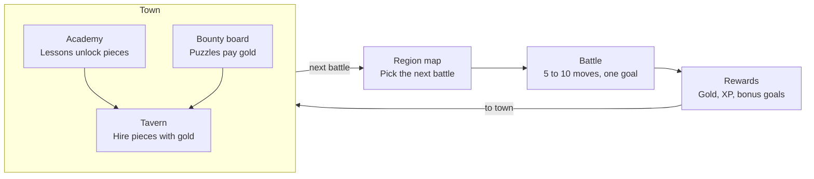

# Chess RPG Gauntlet — Game Design Doc

October 21, 2026 · Exported from the [Claude Doc](https://claude.ai/artifact/VefDVarJQaXZKM4xbvPBAU)

## Vision and pillars

A fantasy tactics RPG that teaches real chess. You are a king who starts with almost no army, recruits pieces by learning how they work, and fights short, puzzle-like battles that build up to a full game against the Lich King. It plays like Into the Breach: short battles, nothing hidden, and every turn a small puzzle with a clever answer.

**Audience:** players who know how the pieces move and want to get better. The game opens by asking "Do you know how the pieces move?"; answering no starts the optional "Teach me the moves" tutorial.

**Pillars**

1. **The rules of chess are sacred on the board.** No terrain that changes movement, no extra moves, no rule-bending powers. The RPG lives around the board, so every skill carries over to real chess.
2. **Short, sharp battles.** Most battles last 5 to 10 moves and have a clear goal. Full games are saved for bosses.
3. **Every reward teaches.** Prices, unlocks and bonus goals all reinforce a chess idea, like piece values, tactical patterns or safe-move habits.
4. **Mistakes are cheap, lessons are clear.** Losing a battle or a piece never ruins a run. A review after each battle always shows what went wrong.
5. **Help that fades.** Assists like threat highlights scale down with difficulty and skill, so players build the habit instead of leaning on the hint.

**Setting:** an animal kingdom of ancient magic, told like a storybook. Each piece type is a species whose body hints at how it moves: frog knights hop over pieces, tortoise rooks carry a castle on their backs. Factions differ by outfit and color. The final villain is the Lich King, who leads skeleton versions of every species (a light wink at Lichess).

## Core loop

Pick a battle on the region map, win it for gold and XP, then spend in town before the next battle.

Lessons at the academy unlock which pieces the tavern sells, and puzzle bounties top up gold. Clearing a region's battles opens its boss duel, which leads to the next region.

## Battles

Battles are short scenarios on a standard 8×8 board, each with a goal, a move limit and bonus objectives. They borrow what makes Into the Breach fun without changing how pieces move.

| Into the Breach | Chess version |
| --- | --- |
| Enemies show their attacks in advance | **Threat Sight:** highlights squares the enemy attacks and your undefended pieces. Fades with difficulty. |
| Battles last about 5 turns | Move limits: "checkmate within 6 moves", "survive 8 turns" |
| Goals beyond killing (protect buildings) | Protect villages, escort a squire to promotion, capture the standard-bearer |
| One shot hits two enemies | Forks, skewers and discovered attacks are detected and celebrated |
| Bonus objectives | "Win without losing a piece", "Use a pin", "Under 10 moves" → extra gold |
| One Reset Turn per battle | Rewind charges (see Powers and rewind) |

**Battle types**

1. **Skirmish:** small armies. Checkmate, or win material within a set number of moves.
2. **Ambush:** a real puzzle position ("the enemy walked into your trap, find the strike"), then play it out to a win against the AI. Turning an advantage into a win is a skill puzzles alone don't teach.
3. **Siege:** survive a set number of turns while protecting village squares. Teaches defence and prophylaxis.
4. **Promotion run:** escort a squire to the far rank, where it's knighted in a promotion ceremony. Teaches pawn endgames.
5. **Boss duel:** a nearly full or full game against a faction leader.

**Tactic detection.** When a move creates a known pattern, the game shows a banner like **FORK!**, **PIN!** or **SKEWER!** and pays bonus gold, like a combo in a fighting game. A banner must only appear when the tactic really works, or it teaches the wrong lesson: a "fork" where the forking piece simply gets captured is not a fork. So each banner needs two checks: a board rule spots the pattern, and the engine confirms the move actually wins something.

- **At launch (clear board rules):** checkmate, fork, double check, discovered attack, pin, skewer, back-rank mate, promotion.
- **Puzzles only (need judgment):** deflection, attraction, overloaded piece, zwischenzug, clearance, interference. These are hard to name automatically in live play, so they appear in puzzles, where the Lichess database already tags them.
- The prototype already detects checkmate, fork, check, promotion and capture, without the engine check yet.

**Scenario format** (one JSON file per battle): starting position (FEN), goal, move limit, enemy faction and AI settings, bonus objectives, rewards, and the dialogue before and after.

## Your army

You start as a king with one companion and two squires, and build toward a full chess set by learning and earning.

**Starter companion.** Pick a frog knight, a heron mage (bishop) or a tortoise golem (rook), Pokémon-style. The starter is a named character who acts as your main tutor: they speak in dialogue, comment on your moves, level up and stay with you all game. Each starter comes with 2 mouse squires (pawns), because King + Bishop or King + Knight alone can't checkmate a lone king.

**Hiring rules**

- A piece type can only be hired after its lesson is done at the academy.
- Army size is capped at a real chess set: 8 pawns, 2 knights, 2 bishops, 2 rooks, 1 queen.
- Price equals standard piece value, so players learn values just by shopping.

| Piece | Species | Why it fits | Value | Price |
| --- | --- | --- | --- | --- |
| Pawn | Mouse squire | Small, and there are many | 1 | 10g |
| Knight | Frog | Jumps over other pieces | 3 | 30g |
| Bishop | Heron or owl mage | Robed and scholarly | 3 | 30g |
| Rook | Tortoise | Castle on its back, moves in straight lines | 5 | 50g |
| Queen | Fox sorceress | Fast, goes anywhere | 9 | 90g |
| King | Stag or lion | Regal; this is you | — | — |

**Wounds, not permadeath.** A captured piece is wounded and sits out the next battle. If you win, sacrificed pieces return right away with a Valor bonus. Permadeath would teach players never to sacrifice, which is bad chess.

**Pieces as tutors.** Besides the starter, each piece type has a character voice that teaches its tactics: the frog knight teaches forks, the heron mage teaches pins and long diagonals, the tortoise teaches back-rank mates. Pieces earn XP and titles with small meta perks (like +1 hint), never new moves.

**Avoiding grind.** Gold comes from varied, short content: battle rewards, bonus objectives, side quests, and a tavern bounty board of puzzles. No required replays of the same practice game.

## Enemies and difficulty

Each region has one faction built around a headline chess theme, and also revisits earlier themes (see Curriculum). Enemies grow from a handful of pieces to a full set, and their AI gets stronger along the way. Every faction uses the same species for each piece type; outfit and color tell factions apart.

| Region | Faction | Look | Army style | Headline theme |
| --- | --- | --- | --- | --- |
| 1 | Bog Goblins | Muddy rags, scavenged gear | Many pawns, a goblin chief as king | Threat awareness, protection, safe trades, basic checkmates |
| 2 | Bandit Riders | Masks and cloaks | Knight-heavy | Forks, double attacks, mating patterns |
| 3 | Shadow Cult | Purple hoods, crystals | Bishops and a queen | Pins, skewers, discovered attacks |
| 4 | Iron Legion | Plate armor | Rooks and pawns | Development, king safety, open files |
| 5 | Bone Wardens | Skeleton animals, the Lich's vanguard | Small elite armies | Promotion, king activity, endgames |
| Final | The Lich King | Skeleton versions of every species | Full army | Complete games |

An optional Bog Goblin boss could use the Horde chess variant (36 pawns, no king). That needs a variant engine such as Fairy-Stockfish.

**AI personalities.** Enemy commanders have readable habits that create lessons. Bog Goblins shout their next move and must play it if it's still legal (see Powers and rewind). The Iron Legion warlord always grabs free material, which teaches traps. The cult leader pins everything, which teaches unpinning. Personality is a layer over the engine: weighted move choice among the engine's top candidates.

**Human-like mistakes.** Stockfish at low skill levels mixes perfect moves with random blunders, which feels unnatural. Early enemies should make believable mistakes, like missing a fork or leaving a piece undefended. Use a small custom engine or a shallow search with noise early on, and bring in Stockfish for later regions.

**Difficulty in two layers**

- **Global setting:** Squire / Knight / Champion / Grandmaster. Sets the AI strength offset and how much help you get (Threat Sight, blunder warnings, rewind charges).
- **Adaptive rating:** a hidden rating (Glicko-style) from puzzles and battles keeps the AI near the player's level, with the global setting as an offset.

## Powers and rewind

Undo is unlimited in training and limited in battles, like Into the Breach's one Reset Turn. Scarce rewinds are what make players double-check before moving, and that habit is the skill being taught.

| Context | Undo | Hints | Why |
| --- | --- | --- | --- |
| Lessons and training grounds | Unlimited | Free | Safe space to explore |
| Battles | Rewind charges (start with 1) | Paid with powers | Consequences build the blunder-check habit |
| After every battle | Full review | Best move shown | Learn from the biggest mistake |

**Rewind relics.** Rewind can be upgraded: more charges per battle, or rewinding two moves at once.

**Learning-friendly powers**

- **Scrying Orb:** shows the enemy's threat, the move they would play if you did nothing. It reveals their plan, not just the squares they attack. Teaches "what does my opponent want?"
- **Far Sight (Orb upgrade, bought in town):** hover a piece over a square to see the enemy's best reply to that move. Trains "if I go here, then they…" thinking.
- **Oracle:** highlights which piece the best move uses, but not where it goes.
- **Blunder Ward:** warns once per battle when you're about to leave a piece undefended.
- **Threat Sight:** always available on easy difficulty, a limited power on harder ones.

**One feature, three uses.** Shouting goblins, the Scrying Orb and Far Sight all ask the engine the same question: what is the enemy's best move in this position? Goblins announce it automatically and commit to it, the Orb shows it on demand, and Far Sight asks it about a move you haven't made yet. Together they teach the habit in order: first the enemy says its plan out loud, then you pay to see it, then you learn to work it out yourself.

**Deferred: free rewind.** A free rewind for spotting your own mistake is on hold because every version so far was confusing. Revisit after playtests, if at all.

**Banned power types:** anything that changes how pieces move, gives extra moves, swaps pieces, or adds terrain. Fun, but they teach the wrong chess.

## Campaign and Gauntlet

The Campaign, with regions that build chess skills in order, is the core of the game and gets built first. A Gauntlet replay mode may come later.

**Campaign.** An optional tutorial, then a map of 5 regions and the final battle. Each region has:

- 4 to 6 battles, chosen from a branching map like Into the Breach's islands
- a town with a tavern (hire pieces), an academy (lessons), and a bounty board (puzzles for gold)
- a boss duel against the faction leader

Lessons learned and pieces unlocked are permanent. Losing a battle never costs the save; how much it costs depends on difficulty.

| Difficulty | Losing a battle costs |
| --- | --- |
| Squire | Nothing: retry right away, pieces recover |
| Knight | Captured pieces are wounded and sit out the next battle |
| Champion | Wounds, plus a quarter of your gold |
| Grandmaster | Wounds, gold, and the battle is gone from the map with its reward |

**Gauntlet (deferred).** A replay mode like a run in Into the Breach or Slay the Spire: random battles, relics and a fresh army each time, and the run ends when you lose. Lesson unlocks would carry over between runs. Deferred until the campaign works; revisit if players want more.

## Curriculum

The order follows how chess is commonly taught: the Lichess [Learn](https://lichess.org/learn) and [Practice](https://lichess.org/practice) sequences, arranged as a spiral like the Dutch Steps Method, a widely used six-step course. Each region has a headline theme but also brings back earlier themes at a harder level, so tactics, checkmates and endgames recur instead of appearing once. Lessons are our own writing; Lichess is the outline.

| Tier | Region | Headline theme | Also revisits | Lichess source | Puzzle tags for bounties |
| --- | --- | --- | --- | --- | --- |
| 0 (optional) | "Teach me the moves" tutorial, for total beginners only | Movement, captures, check, mate in one | — | Learn: chess pieces, fundamentals | mateIn1 |
| 1 | Bog Goblins | Threat awareness, protection, safe trades, basic checkmates | Pawn promotion basics | Learn: protection, combat, piece value; Practice: Piece Checkmates I | hangingPiece, mateIn1 |
| 2 | Bandit Riders | Forks, double attacks, mating patterns | Safe trades | Practice: The Fork, Double Check, Checkmate Patterns | fork, doubleCheck, mateIn2 |
| 3 | Shadow Cult | Pins, skewers, discovered attacks, x-rays | Forks, mating patterns | Practice: fundamental tactics | pin, skewer, discoveredAttack, xRayAttack |
| 4 | Iron Legion | Development, king safety, open files, improving inactive pieces | All fundamental tactics, back-rank mates | Our own lessons | backRankMate, kingsideAttack |
| 5 | Bone Wardens | Promotion, king activity, opposition, rook endgames | Tactics in the endgame | Practice: pawn and rook endgames | pawnEndgame, rookEndgame, promotion |
| Final | The Lich King | Complete games | Everything | Practice: advanced tactics as bonus content | deflection, attraction, intermezzo |

Tier 4 needs our own lessons: Lichess Learn covers only board setup and castling, and Practice and the puzzle themes barely touch opening principles or strategy. Puzzle tags follow the Lichess puzzle database's theme names; check exact spellings when building the pipeline.

## Art direction

Storybook fantasy in an animal world, at least as polished as Into the Breach, with XCOM-style dramatic moments. The style reference is inked outlines, painted textures, and muted olive, plum and leather tones with jewel-colored accents.

**Board pieces are figurines.** Each board piece looks like a piece from a themed chess set: an animal character on a round base, wearing headgear that echoes the classic piece's top. It reads as both a character and a chess piece at a glance.

| Piece | Classic shape it echoes | Figurine |
| --- | --- | --- |
| Pawn | Round head on a small body | Mouse squire in a round helmet |
| Knight | Horse head | Frog in a horse-head helm |
| Bishop | Mitre with a slit | Heron or owl mage in a tall slit hood |
| Rook | Crenellated tower | Tortoise with a castle-tower shell |
| Queen | Pointed coronet | Fox sorceress in a pointed crown |
| King | Crown with a cross | Stag or lion in a cross-topped crown |

- **Two levels of art.** Board figurines use bold silhouettes and a faction-colored base that still read at about 45 px per square on a phone. Full illustrations are for portraits, dialogue, the shop and capture moments.
- **Classic pieces toggle.** Players can switch to standard chess pieces, so what they learn carries over to real chess.
- **Motion teaches movement.** The frog knight hops in an arc, the tortoise stomps in a straight line, the heron glides diagonally.
- **XCOM-style moments in 2D.** A capture gets a short illustrated close-up, a brief freeze and screen shake.
- **Asset pipeline.** AI image generation (through OpenRouter) for concepts and sprites, cleaned up by hand to a locked style sheet. Animation uses tweens (hops, squash and stretch, particles) rather than frame-by-frame drawing.

## Tech stack and deployment

Use a web stack built on TypeScript, not Godot, because the chess tools (rules, engine, puzzle data) are all JavaScript-friendly.

| Layer | Choice | Notes |
| --- | --- | --- |
| Build | Vite + TypeScript | Static output, instant reloads |
| Game screens | Phaser 4 | Region map, town and board all drawn on the canvas |
| Long text and settings | HTML overlay | Settings, dialogue logs and accessibility text sit on top of the canvas |
| Chess rules | chess.js (BSD) | Legal moves, FEN, game state |
| AI | Stockfish lite WASM, single-threaded | Runs in a Web Worker; the prototype's engine file is 1.8 MB |
| Enemy personalities | Choice among Stockfish's candidate moves | Picks within a centipawn window, so weak enemies make human-looking mistakes |
| Puzzles | Lichess puzzle database (CC0) | Pre-filter to tens of thousands, split into small JSON files at build time |
| Hosting | Cloudflare static assets, free tier | 25 MiB per-file limit |
| iOS | Capacitor | Wraps the same web build |
| Saves | Local storage first | Cloud sync later if needed |

**Why Phaser.** The region map and town are drawn on the canvas, not just the board, so a full game framework pays off: scenes for map, town and battle, asset loading, input, tweens, particles, camera shake and zoom, and sound. Phaser 4 is the current version (4.2.1 as of October 2026).

**Board scene behind one interface.** The game rules (`src/game`) contain no screen code. The battle scene talks to them through a small interface: show a position, animate a move, highlight squares, play a capture. If 3D is wanted later, only the battle scene's board is rebuilt.

**Three.js later, if 3D is worth it.** A 3D look could be "HD-2D" (the same 2D figurines in a lit 3D diorama with a moving camera) or full 3D models. Phaser keeps running the map and town; the battle board would be drawn by Three.js on a second canvas layered with Phaser's. Rules, menus and art carry over. Full 3D characters (modeling, rigging and animating about 36 of them) are the expensive part, not the engine.

**Why not Godot.** A slow export step, bridging to Stockfish yourself, a bigger web download, and every menu built in Godot's UI system.

## Licensing

Decided: the game is open source under GPL-3, so Stockfish ships with it.

| Asset | License | What it means for us |
| --- | --- | --- |
| Lichess puzzle database | CC0 (public domain) | Free to use and ship |
| chess.js | BSD-2 | Free to use, keep the notice |
| Stockfish | GPL-3 | Game source must be published under GPL-3 if we ship it |
| chessground (Lichess board UI) | GPL-3 | Same as Stockfish; or write our own board |
| Lichess site code (lila) | AGPL-3 | Don't copy code unless the game is AGPL too |
| Learn and Practice lesson text | Not checked | Write our own lessons; use theirs only as an outline |

- GPL apps can ship on the App Store: the official Lichess mobile app is GPL-3 and on the App Store.
- Every build ships Stockfish's license file; the prototype already does.
- Keep "Lichess" out of the game's name and branding. The canonical code repo is lichess-org/lila; the alexbarrett/lichess link looks like an old copy.

## Prototype plan

A battle prototype is built: 5 handmade battles, goals beyond checkmate, Threat Sight, rewind, tactic banners, difficulty levels, and a Stockfish enemy with a personality layer. It uses a plain DOM board and placeholder art, and feels like a compelling direction. Next steps:

1. **Art spike:** a Phaser board with figurines for two species and the hop and stomp animations, tested on a phone-sized screen, plus candidate figurines (stag or lion, heron or owl) to pick species from.
2. **Scrying Orb ladder:** shouting Bog Goblins, the Orb, then Far Sight.
3. **Starter companion:** pick a starter and hear their tutor lines in battle.
4. **One town:** hiring by value, one academy lesson, and a bounty board with 50 puzzles from the Lichess database.
5. **Region 1 boss:** the goblin chief duel.
6. **Playtest:** watch 3 to 5 people play, ideally beginners, before building more.

## Open questions

- [ ] King species: stag or lion? Bishop: heron or owl? Candidates are in `art/candidates/`.
- [ ] How do battles use your army, and do wounds stay? Proposal: most battles give a set lineup from pieces you own, boss battles let you pick pieces up to a points budget, and wounds are dropped.

## Decision log

| Date | Decision |
| --- | --- |
| 2026-10-21 | Tutorial entry: the game asks "Do you know how the pieces move?" |
| 2026-10-21 | Champion difficulty loses a quarter of your gold on a lost battle; tune in playtests |
| 2026-10-21 | Gauntlet mode deferred |
| 2026-10-21 | Phaser 4 for the map, town and board; Three.js only later, if 3D is worth it |
| 2026-10-21 | Audience: players who know the moves; optional "Teach me the moves" tutorial for total beginners |
| 2026-10-21 | Campaign first |
| 2026-10-21 | Open source under GPL-3, so Stockfish ships with the game |
| 2026-10-21 | Losing a battle costs more on harder difficulties, never the save |
| 2026-10-21 | Tactic banners need a board rule plus engine confirmation; 8 patterns at launch |
| 2026-10-21 | Free rewind deferred: too confusing as designed |
| 2026-10-21 | Scrying Orb ladder: shouting Bog Goblins, then the Orb (threat), then Far Sight (what-if upgrade) |
| 2026-10-21 | Curriculum follows the Lichess Learn and Practice order as a spiral (Steps Method style): optional tutorial, 5 regions, final battle |
| 2026-10-21 | Starter is a named companion who acts as the main tutor |
| 2026-10-21 | Animal world: one species per piece type, factions told apart by outfit; board pieces are figurines; classic pieces toggle |
| 2026-10-21 | Battles are short scenarios; the rules of chess never change on the board |
