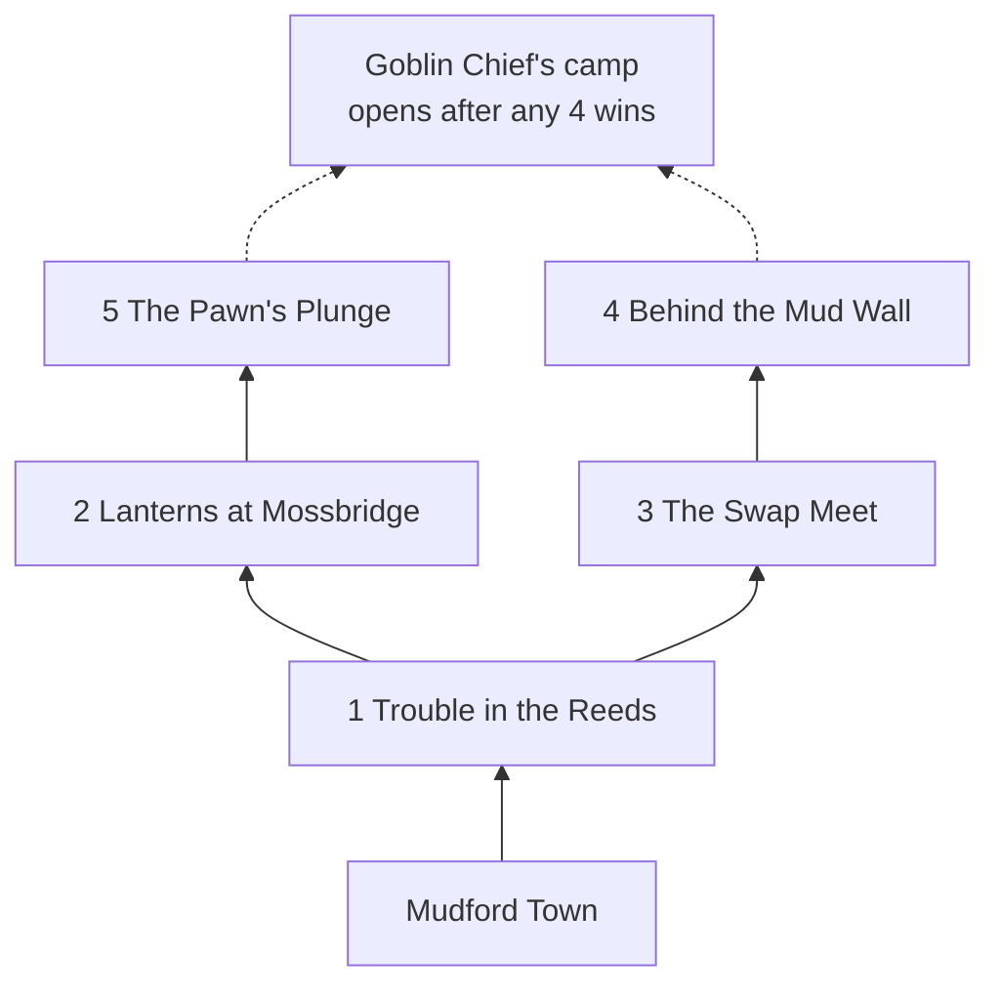
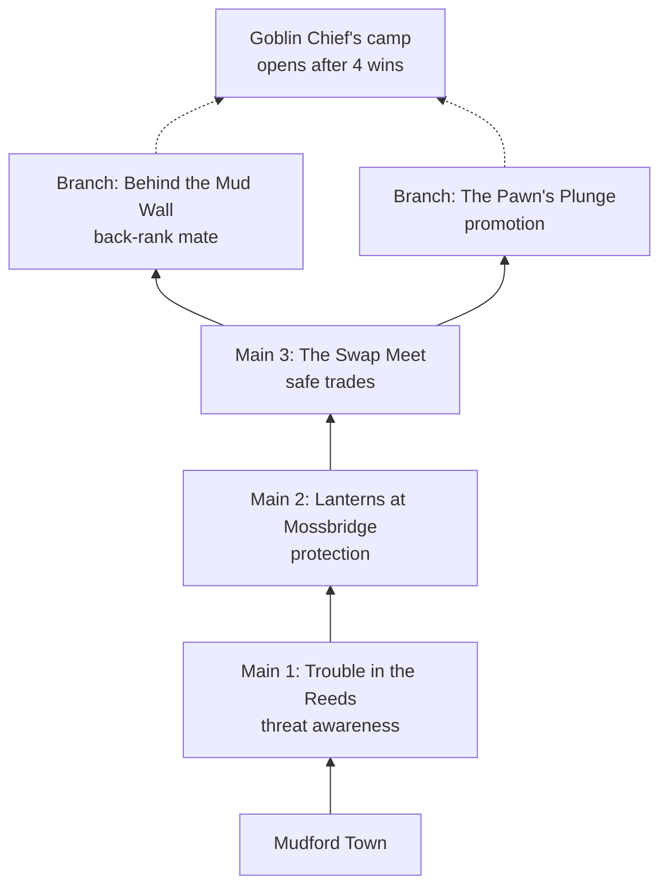

# Region 1: Bog Goblins

[Design overview](../../design.md) · [Campaign and curriculum](../campaign.md) · [Story and characters](../story.md) · [Battle rules](../systems.md#battles) · [Region template](region-template.md) · [Playbook](../../playbook.md)

## Design status

Built, deployed and engine-verified ([play it](https://unformedideas.com/chess-rpg/)); not yet playtested with people. Two pieces of work are in flight: the faction's new species art, and Grubnak no longer shouting. This page describes both as decided. A third is approved but not specced: the [guided path](#planned-guided-path) revision. This is the worked example for every later Region: it follows the [Region template](region-template.md), and the [playbook](../../playbook.md) describes how it was built and checked. Implementation history is in the [build progress](../../progress.md).

| | |
| --- | --- |
| Faction | Bog Goblins: their own swamp creatures (bog rats, salamanders, crows, snapping turtles, vipers and Grubnak the Toad Chief) in muddy rags, wearing the same chess headgear as ours ([Art](../art.md)) |
| Headline theme | Threat awareness, protection, safe trades, basic checkmates; revisits pawn promotion basics |
| AI habit | **Shouting:** before your move the goblins announce the move they'd play if you passed, and must play it if it's still legal ([details](#ai-habit-shouting-goblins)) |
| Battles | 5 on a branching map; the boss opens after any 4 wins |
| Academy | Rook and queen checkmates (Lichess Practice: Piece Checkmates I) |
| Bounty tags | `hangingPiece`, `mateIn1` |
| Boss | Grubnak, the Goblin Chief: a 10-point budget, no queen, and he doesn't shout |
| Hero | Saffron, the Fox Queen |
| Places | The Bog (region), Mudford Town, the Muddy Mug tavern |

## AI habit: shouting goblins

Before each of your moves, the goblins announce the move they would play if you passed (`src/ai/shout.ts`). It's drawn as a green arrow and spoken by the piece's portrait. If the announced move is still legal after your move, they must play it ("Told you I would!"). If you made it illegal, a "Foiled!" banner shows. A rewind hears the same shout again.

**Changing (approved 2026-10-23, [#4](https://github.com/avoidthekitchen/chess-rpg-gauntlet/issues/4)):** the must-play rule breaks the [tell or tilt](../systems.md#ai-habits-by-faction) rule, because it teaches that opponents walk into traps. Goblins will keep announcing, then decide again after your move. The shouted move gets a capped weight bonus in the enemy's [one weighted pick](../systems.md#ai-habits-by-faction), so goblins usually keep a plan that's still fine and usually drop one that's become bait, but players can't count on either. When they switch because you guarded or moved the target, they say so ("Oi! You've guarded it!"). The rule is introduced as "They shout their plan. Your move can change it.", and the companion adds that the arrow is one plan: other threats still count. A rewind still hears the same shout. The battles below were built around the must-play rule, so they're re-verified and redesigned where a trap only worked because the shout was forced.

It teaches the first rung of the ladder in [Powers and rewind](../systems.md#powers-and-rewind): the enemy says its plan out loud. Because the goblins are committed, you can also set traps, such as guarding the piece they promised to take. That makes battles feel like Into the Breach turns, where each turn is a small puzzle.

On Gentle, your companion reads each shout for you a moment later. It says whether the target is guarded, whether the trade is fair, or that a village or your king is the target. Brave leaves it to you ([help that fades](../../design.md#vision-and-pillars)).

## Map

The first skirmish opens both paths, so one battle can be skipped (`src/game/region1.ts`). Cleared battles show a star per bonus goal earned.

## Battles

All five are in `src/game/region1Battles.ts`, which includes a comment per battle explaining the position. A strong simulated player wins each 96–100% of the time on Gentle and Brave, and careless play wins 0–17% ([verification](#verification)).

| # | Battle | Kind · theme | Goal | The idea | Moves (strong player) | Reward · bonus goals |
| --- | --- | --- | --- | --- | --- | --- |
| 1 | Trouble in the Reeds (Goblin Scouts) | Skirmish · threat awareness | Win 6 points of material within 8 moves | Two threats at once (a pawn on your bishop, a bishop on your knight); the shout says which is coming. Dodge to a square that hits something loose, then handle a second wave | 4–5 | 15g · flawless, no rewind |
| 2 | Lanterns at Mossbridge (Mudfoot Raiders) | Siege · protection | Keep villages c3 and f3 safe for 7 enemy turns | Raiders (the village-hunting AI) aim at the villages' guards first. Keep each village guarded at least as often as it's attacked, and capture every raider that lands | about 7 | 20g · flawless, no rewind |
| 3 | The Swap Meet (Goblin Hagglers) | Skirmish · safe trades | Win 8 points within 9 moves | The shout grabs a loose knight. Move it somewhere that still guards the square, so the promised capture loses a rook. Then count attackers and defenders before each trade | 4–5 | 20g · within 6 moves, no rewind |
| 4 | Behind the Mud Wall (Bogwall Sentries) | Skirmish · basic checkmates | Checkmate within 8 moves | Two guards watch the back rank. Remove them one at a time (or let a shout drag one away), then mate on the back rank | 4–6 | 20g · within 5 moves, no rewind |
| 5 | The Pawn's Plunge (Puddle Runners) | Promotion run · promotion basics | Promote safely within 10 moves | A knight blocks your passed pawn while goblin pawns race toward your king. Clear the path, answer the shouts that matter, and only promote where the new piece is safe | about 6 | 25g · flawless, within 7 moves |

Lineups are set by the scenario: your hired pieces stand in as named characters (starter first), and the rest are unnamed militia ([rule](../systems.md#battles)). Across the five battles, White has a knight, a bishop and a rook in at least three each, so every starter usually appears named.

## Academy

As built, one lesson, taught by Sage Ollie: **Rook and queen checkmates**, as two practice battles (The Queen's Net, The Rook's Box) with unlimited undo against a lone king that defends perfectly. The first clear of each pays 10g (`src/game/academy.ts`).

The [guided path](#planned-guided-path) replaces this academy with a warm-up in each battle node; these two exercises become Grubnak's boss practice.

## Planned: guided path

Approved 2026-10-22, not yet built. Region 1 is revised to the [guided path](../campaign.md#guided-path) as the worked example for every later Region. The code changes will be specced in a GitHub issue ([open TODO](../decisions.md#open-todos)).

| Battle | Warm-up idea | Warm-up tag |
| --- | --- | --- |
| Trouble in the Reeds | "What do they want?" Look at every check, capture and threat | `hangingPiece` |
| Lanterns at Mossbridge | "Guard it, move it or block it" | `defensiveMove` |
| The Swap Meet | "Count attackers and defenders" | `hangingPiece` |
| Behind the Mud Wall | "The back rank" | `backRankMate` |
| The Pawn's Plunge | "Run it home safely" | `promotion` |
| Grubnak (boss practice) | The Queen's Net and The Rook's Box, as built: played out to mate, unlimited undo, skippable | — |

Also planned: the academy becomes the library (with a review set), bounty tags add `defensiveMove`, `backRankMate` and `promotion`, refresher bounties, and the in-battle lesson panel cut to a one-line reminder: "Checks, captures, threats: theirs, then yours." The battles themselves don't change, so their verification stands.

## Bounty board

Four bounties at a time come from real Lichess puzzles, spread across ratings so pay differs. The packs contain 150 `mateIn1` and 150 `hangingPiece` entries, rated 400–1899. Puzzle deduplication is complete: the loader removes 12 shared IDs, leaving 288 unique puzzles. The build script also prevents duplicates across future packs. The board refreshes after every battle, and each bounty gets one try ([rules](../systems.md#bounty-board-and-gold)). The puzzle files are built by `npm run puzzles` into `public/puzzles/region1/`.

## Boss: Grubnak's Last Stand

- **Setup:** you pick up to 10 points from the pieces you own (no queen) on the muster screen, placed on their usual home squares. Grubnak, the Goblin Chief, sits behind a full wall of eight pawns and one knight (11 points) (`src/game/region1Boss.ts`).
- **Goal:** checkmate, with no move limit. 50g, plus 10g each for no rewinds and for winning within 30 moves.
- **He doesn't shout:** this is the region's final exam. The habit the shouts taught ("what does the enemy want?") has to work without them. Without shouts he played 40–50 move games, so he's a little clumsier on Gentle and Brave ([tuning values](../systems.md#tuning-values)).
- **The lesson:** develop, keep pieces protected, trade only when it's safe, open a file for the rook, then hunt the king.

## Hero: Saffron, the Fox Queen

Locked in Grubnak's pantry and freed when you win. She joins your army as a named hero (a queen) with her own portrait and lines, and says the Lich King sends his bandits next. Grubnak bans queens, so she matters from Region 2 on. She joins only once; replaying the duel pays only bonus goals not yet earned.

## Story beats

- **Arrival:** the Bog Goblins have crept out of the marsh, stealing pots, pies and the occasional village. Your companion explains that they shout their plans. Grubnak taunts you from his camp.
- **Each battle:** a short before-and-after exchange between the companion and that battle's goblin squad (`before` and `after` in each battle).
- **After the boss:** Grubnak gives up the Bog, Saffron is found in the pantry, and she points to the Lich King's bandits: the hook into Region 2.

Characters introduced here: Grubnak and Saffron (recurring; see the [cast](../story.md#recurring-characters)), and five goblin squads named for their battles.

## Art

The Bog Goblin token and portrait set (their species and in-game names are in [Art direction](../art.md)), plus painted backgrounds for the title, the region map, the town and battles.

## Verification

`npm run verify:battles` plays every battle and the boss against the real enemy AI, shout rule included, with simulated players. Results as of the last run:

| Battle | Strong player wins (Gentle / Brave) | Strong player's average moves | Careless player wins (Gentle / Brave) |
| --- | --- | --- | --- |
| Trouble in the Reeds | 100% / 100% | 4.2 / 5.0 | 4% / 8% |
| Lanterns at Mossbridge | 100% / 100% | 7.3 / 7.2 | 17% / 13% |
| The Swap Meet | 100% / 100% | 4.2 / 4.2 | 0% / 0% |
| Behind the Mud Wall | 100% / 100% | 5.5 / 4.6 | 4% / 4% |
| The Pawn's Plunge | 100% / 100% | 5.9 / 6.1 | 8% / 0% |
| Boss duel | Passed the boss bar when the no-shout boss merged (about 92% wins); the full table is to be recorded on the next run | — | — |

A simulated "greedy" player (always grabs the biggest capture) wins Trouble in the Reeds and The Pawn's Plunge fairly often (about 33–67% across runs). That's worth watching in playtests.

## Playtest

Not yet run. The test from the original scope still stands: 3 to 5 people who know the moves but lose to tactics play Region 1. It should take them 30 to 45 minutes; the planned warm-ups add about a minute per battle. Watch where they get stuck or bored, and whether they ask for Region 2. Win rates don't show whether the shout taught anything, so also ask: can they say why a goblin changed its plan, and can they spot a similar threat with no arrow? Once the guided path is built, also watch whether players who know an idea skip its warm-up quickly, and whether the try positions feel too easy or too hard. Record findings here.

## Original prototype scope

Region 1 was the smallest build that tests the whole loop: title, map, town and battle screens, a starter choice, about 5 lesson battles, shouting goblins, a boss with a 10-point budget and no queen, a hero, a tavern, one academy lesson, a bounty board of a few hundred Lichess puzzles, gold, saving, Gentle and Brave difficulties, engine-checked banners for checkmate and fork, and a Cloudflare deploy. Out of scope: Regions 2 to 5, powers, mistake bounties, the adaptive rating, the "Teach me the moves" tutorial, Champion and Grandmaster, sound, iOS and Gauntlet. The step-by-step build is in the [build progress](../../progress.md).

## Optional boss idea

An optional Bog Goblin boss could use the Horde chess variant (36 pawns, no king). That needs a variant engine such as Fairy-Stockfish.
