# Faction art review — issue #60

All requested faction art is implemented in [draft PR #66](https://github.com/avoidthekitchen/chess-rpg-gauntlet/pull/66).
Bandit Riders, Shadow Cult, Iron Legion, Bone Wardens, and the finale use matching board and portrait artwork.
No staging or production deployment is included.

## Delivered assets

| Set | Original illustrations | Runtime files | Includes |
| --- | ---: | ---: | --- |
| Bandit Riders | 14 | 20 | Six tokens, six portraits, Tadwell, and Kingsroad map |
| Bone Wardens and finale | 13 | 19 | Six shared tokens, six shared portraits, and separate Lich King |
| Shadow Cult | 12 | 18 | Six tokens and six portraits |
| Iron Legion | 12 | 18 | Six tokens and six portraits, including General Flint |
| Total | 51 | 75 | Each token produces ivory and ebony sprites |

The 24 cyan-keyed cutouts are committed under `art/tokens/` for future colour tuning.
Three targeted native edits corrected the Bandit queen's crown and tail, and the Cult moth's face.
Raw generations remain local under `art/raw/`.

All generations used the native OpenAI image-generation tool. **OpenRouter spend remains $0.**
The tool chooses its underlying model; no separate model ID is claimed.
Exact prompts, references, generation IDs, and corrections are in [Bandit prompts](../art/bandit-prompts.json) and [remaining faction prompts](../art/faction-prompts.json).

## Art and identity checks

An independent GPT-6 Astra reviewer passed every token set on the real board at 45 px, in both colours and grayscale.
The reviewer compared them with existing ally/Bog artwork and the accepted Bandit set.
All portraits passed species, painted style, transparency, and actual 76 × 104 px card-crop checks.

- Bone remains darker than ivory headgear. Small amber eye glints avoid the cyan key.
- The moth's insect eyes and proboscis replace the rejected mouse-like muzzle.
- Spider eyes and legs, snail shell and tower, and goat horns preserve species and chess roles.
- Legion body armour stays warm grey while only headgear and base change chess colour.
- Flint's grey mane, scar, and uniform distinguish him from the player's young lion.
- Bandit and Cult rooks use top-aligned portrait crops. Tortoise and armadillo rooks keep centred crops.

Region 5 and the finale share Warden tokens and six ordinary portraits.
Only the finale enemy king uses the royal Lich King portrait: introductions, speech, banners, history, map stops, and ending.
Earlier chapter stories do not reveal it, including when replayed after the finale.

## Verification

- `npm run ci`: type-check, production build, and **513 tests passed** across 39 test files.
- Independent code and teaching review: no blockers; 48 targeted tests, TypeScript, generator syntax, and diff checks passed.
- All 73 files added after the Bandit checkpoint decode with transparency: 18 cutouts and 55 runtime sprites.
- Published boards, replies, teaching, progression, and saves are unchanged.
- Chromium checked Regions 3–5 and the finale at 1440 × 1000 and 393 × 852 through normal UI navigation.
- Each chapter accepted a published solver move with zero misses. History retained faction and finale character identity.
- Normal-motion screenshots wait for piece scales to settle, avoiding temporary 0.4-scale entrance frames.
- WebKit used the iPhone 15 device profile and reduced motion at 1280 × 800, 375 × 812, 375 × 553, and 844 × 390.
- All 16 WebKit chapter/viewport checks passed: Gentle advice stayed visible, controls stayed on screen, and history targets measured 44 × 44 px.
- The longest current advice in the remaining chapters, Region 4 defence practice, also fit fully within its panel at all four sizes.
- Keyboard activation opened history; classic/animal toggles worked. A WebKit touchscreen tap also opened history; touch events and coarse pointer were enabled.

Phone views are browser emulation, not physical-device tests.
Story and ending screenshots use completed-chapter fixtures in isolated preview saves. They do not claim a full browser curriculum playthrough.

## Screenshots

The sheets use the real `PhaserBoard` renderer and game-ready WebP assets.
Run `npm run dev`, then open `/art/review/factions.html?faction=warden`, `cult`, or `legion`.

### Bone Wardens and the Lich King

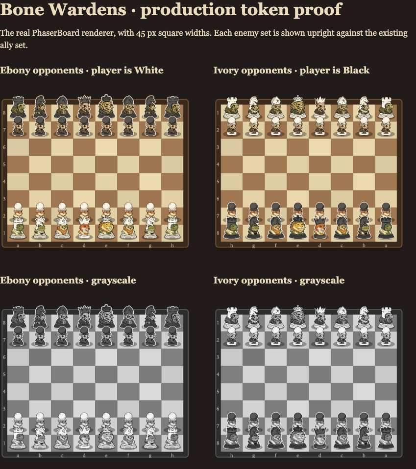

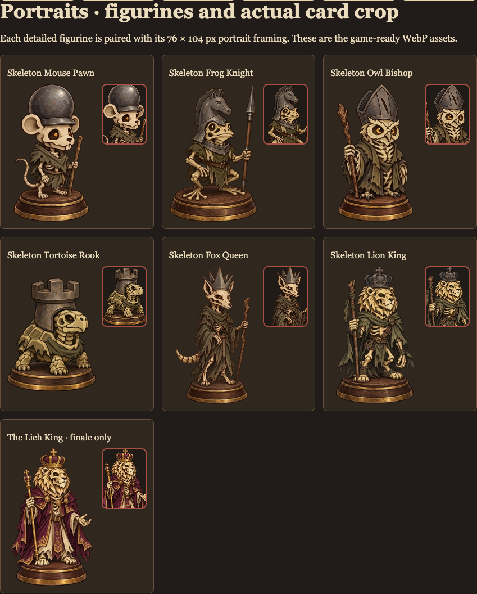

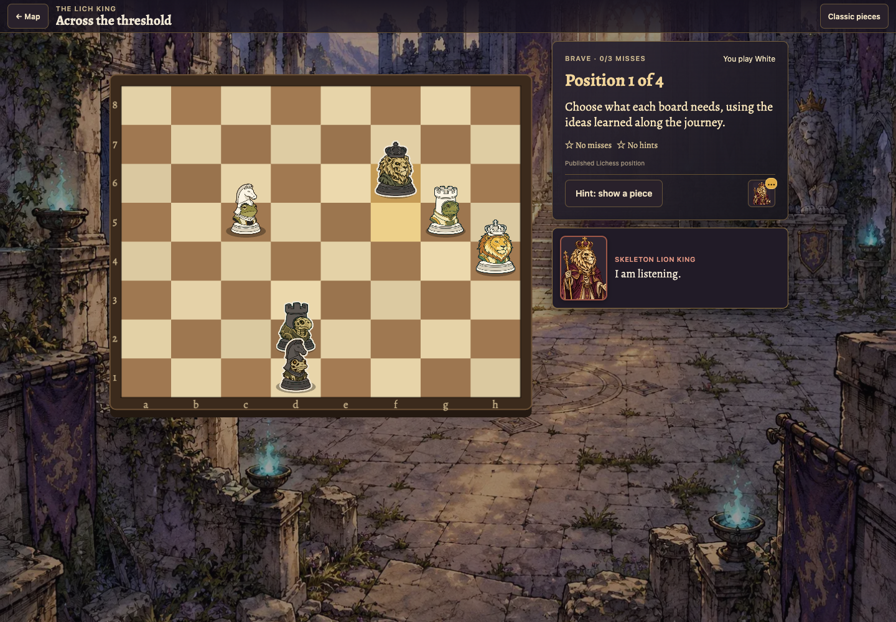

### Shadow Cult

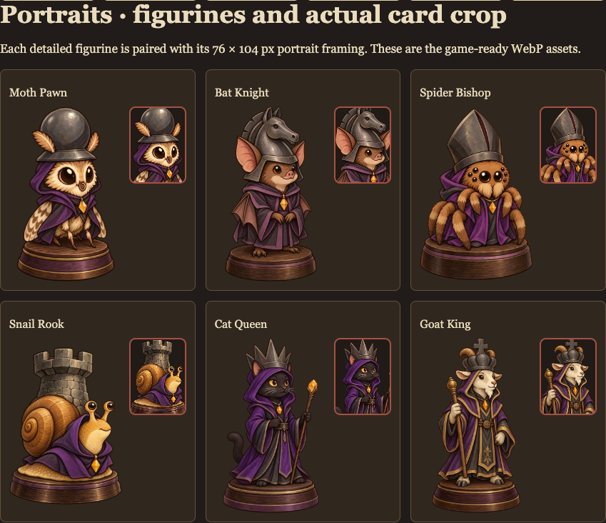

### Iron Legion

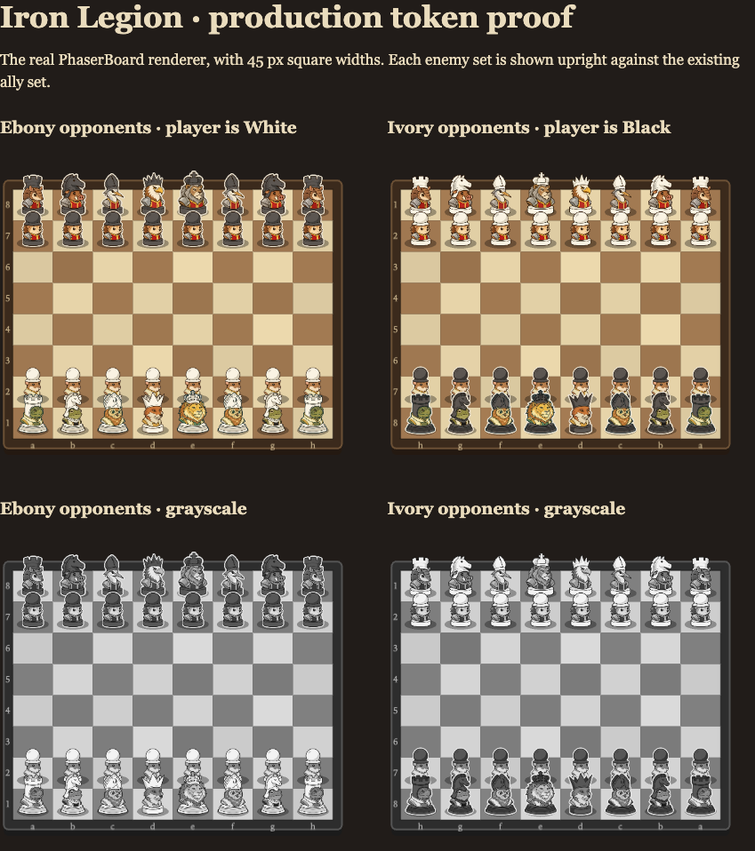

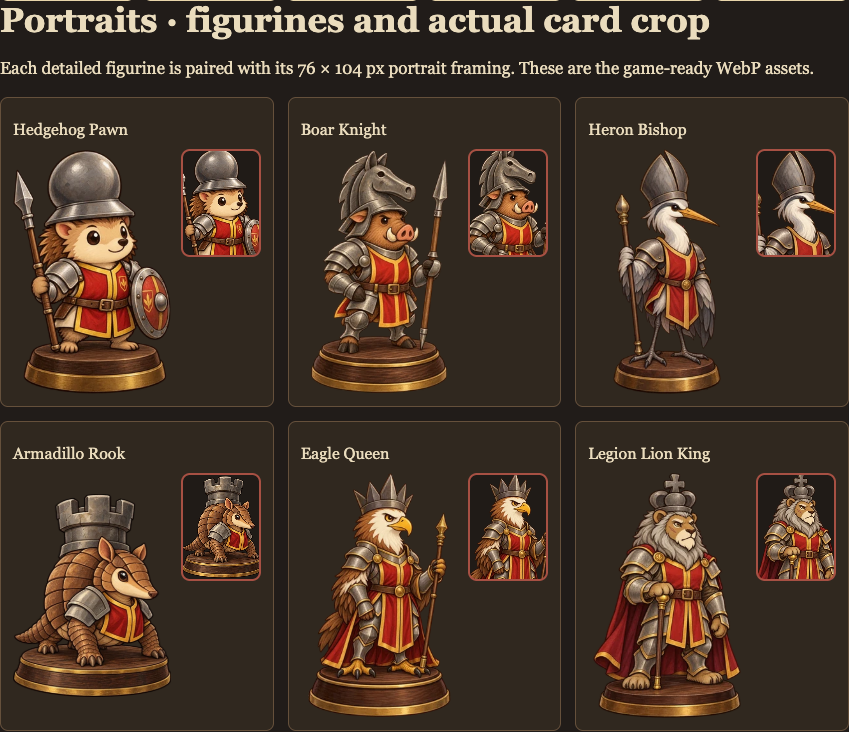

Phone, landscape, and story views

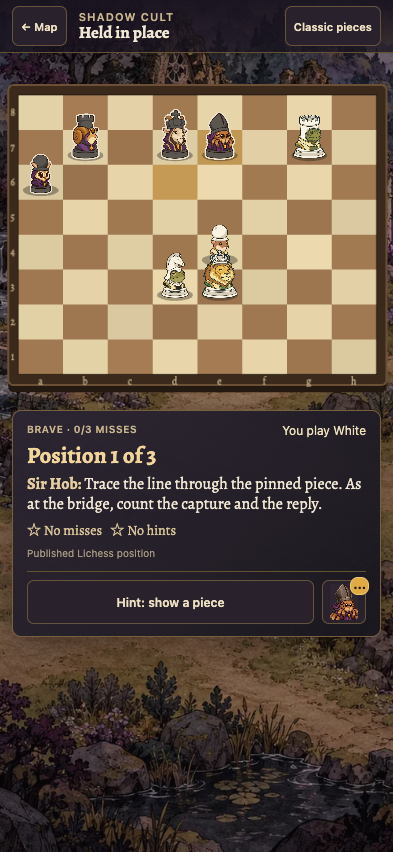

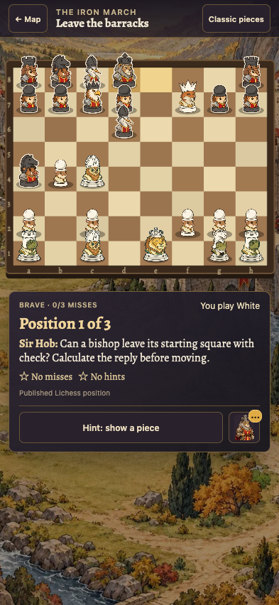

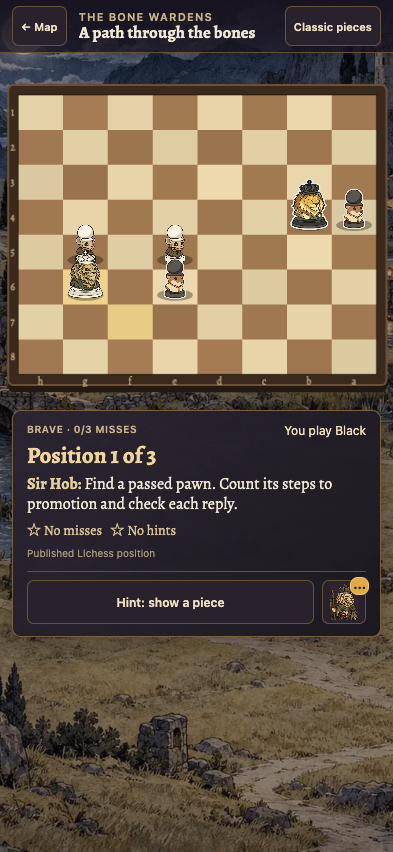

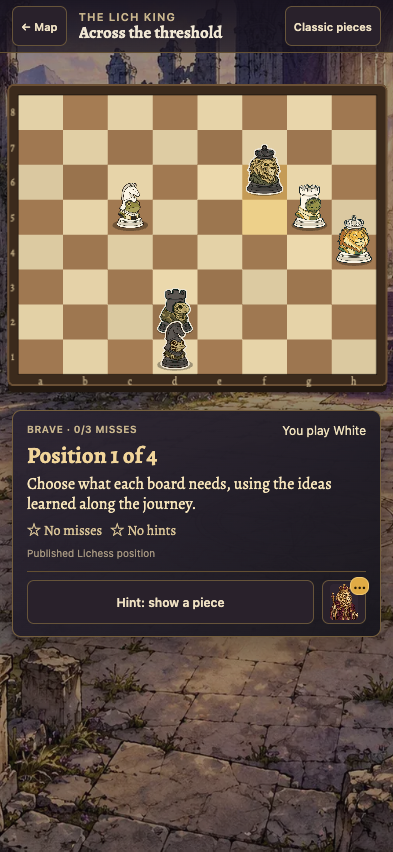

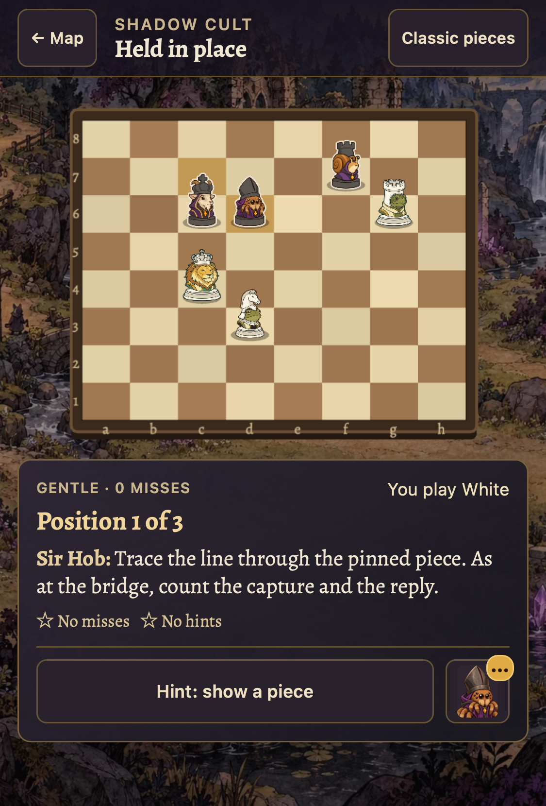

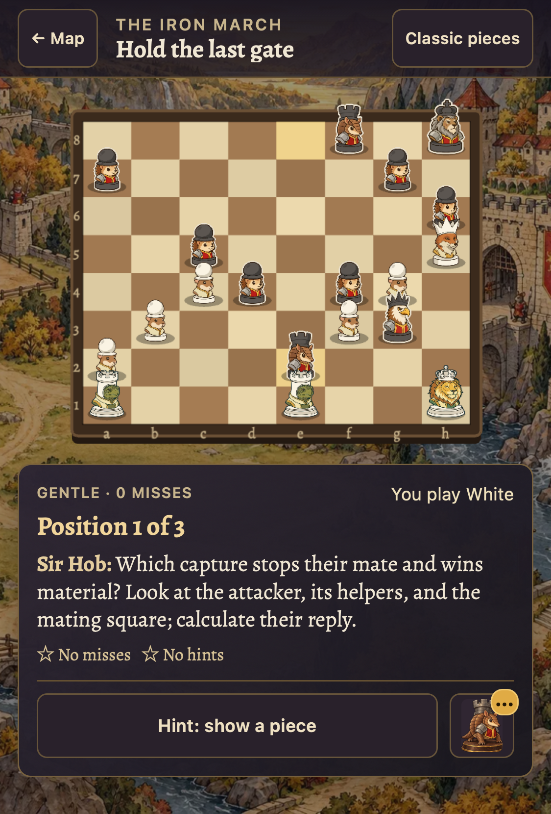

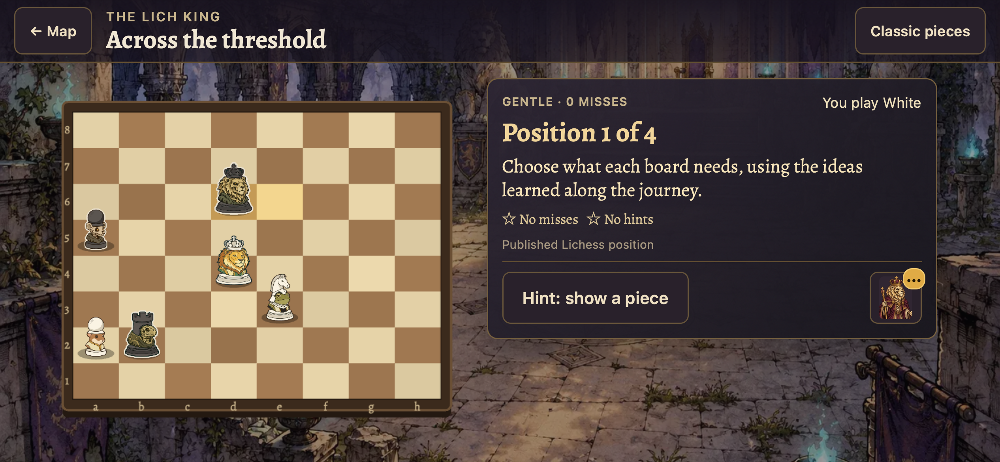

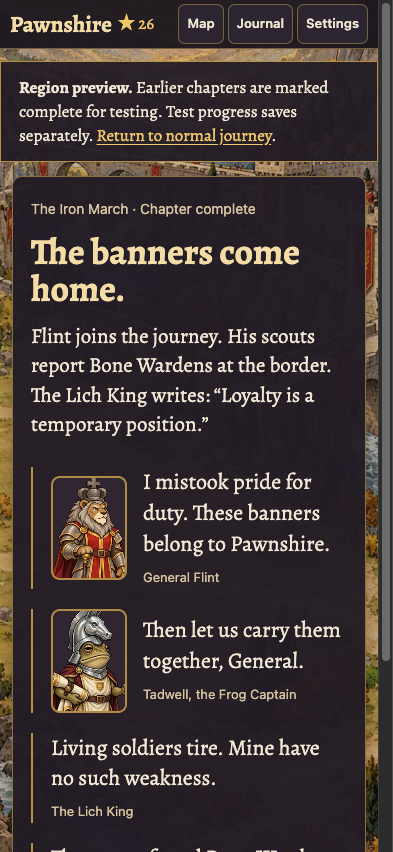

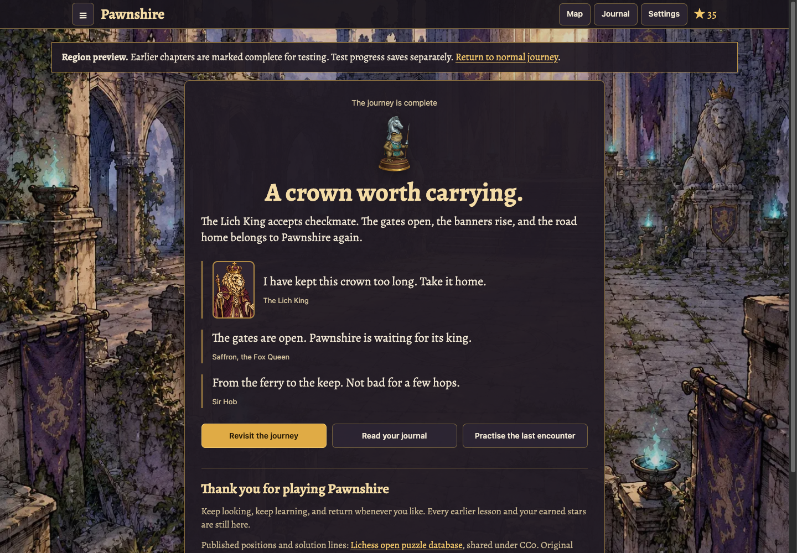

The [Bandit checkpoint](bandit-art-review.md) retains its full screenshots and review history.
